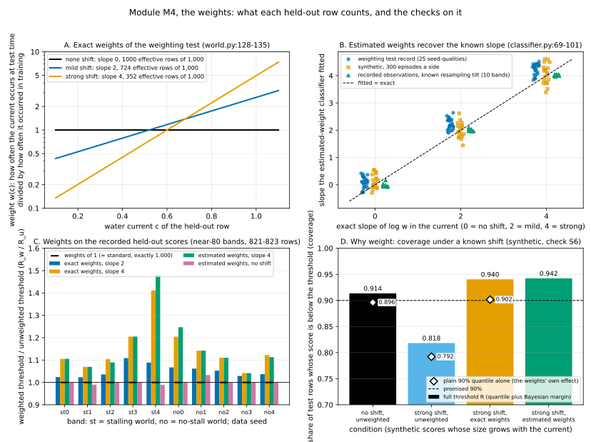

# M4. The weights

**Verdict: works with a caveat.**

**The one sentence for the advisor.** *With weights of 1 weighted BCA is standard BCA to the last bit, and weights
for a known shift do their job; but every weight on record comes from a shift law we know, and weights for the
actor's own commands collapse to a handful of effective rows.*

**In full:** *With every weight equal to 1 the weighted band is the standard band to the last
bit (checked on 42 synthetic held-out sets, on all 10 recorded ThrusterChain bands, and in two studies), and with a
declared shift of the water current the weights do exactly their job (the plain weighted quantile alone brings coverage
back from 79% to 90%; the classifier recovers the shift's slope to within 1% on recorded observations), but every
weight used so far comes from a shift law we know; a deployment has to supply and defend its own ratio, and where that
ratio is the actor's own command law the estimated weights collapse to a handful of effective rows.*

Written 20 October 2026. Code: `calibration/wbcp.py:57-117`, `experiments/shift_iw/world.py:128-164`,
`experiments/shift_iw/classifier.py:27-128`, `experiments/shift_iw/coverage.py:78-97, 251-259`,
`experiments/shift_iw/run.py:549-607`; the four-learner study's `experiments/shift_hosts/iw.py:527-557` and
`PRESPEC.md` section 5.4 (branch `claude/shift-hosts`). Module map: `docs/bca_mechanics/MODULES.md`, section M4.
Reproduction: `docs/bca_mechanics/scripts/M4_test.py` (synthetic checks, the real-data table and the figure) and
`docs/bca_mechanics/scripts/M4_pinned.py` with its bridge job `M4_pinned_job.sh` (the real-data recomputation in the
pinned environment; output `docs/bca_mechanics/data/M4_real_data.json`). Figure: `docs/bca_mechanics/figures/M4.svg`.
Nothing was trained for this document and no band was fitted on study data.

---

## 1. What the module does, in plain words

BCA puts an error band around a **critic**, the learned estimate of how much return a command earns from a state. The
band's half-width is R·u·η(s, a), and R, the **threshold**, is the score below which 90% of the **held-out rows'**
scores fall, with 95% credibility (module M5). A **score** is the size of the critic's error on one held-out row,
divided by the scale the error-size network predicts for it (module M3).

Standard BCA treats every held-out row as equally representative of the rows the band will be used on. That is right
when the test rows come from the same law as the recorded ones. When the test law differs (a **shift**), a held-out row
should count more if its situation is more common at test time and less if it is rarer. Module M4 produces those
counts:

- **The weight w_j** of held-out row j: how often the row's situation occurs at test time divided by how often it
  occurred in training (a ratio of two probability densities).
- **The test mass t**: the weight of the row being certified. In the *per-step* method (the one the owner chose) each
  test step brings its own t = w(its situation). In the *single* method (kept as a comparison) one t serves every step,
  the average weight under the test law.

Module M5 then uses the weights in two places: the plain 90% quantile becomes a *weighted* quantile (rows with larger
weights pull the quantile toward their scores), and in each of the 1,000 posterior draws the row masses and the test
atom's mass are multiplied by w_j and t. Standard BCA is the case w_j = 1, t = 1. Only ratios matter: multiplying every
w_j and t by the same positive number changes nothing.

Three ways of getting the weights exist in the code:

1. **Standard** (weights of 1): the default when no weights are passed (`wbcp.py:66-69`).
2. **Exact**: the shift is a known tilt of the **water current** c (the 11th of the 13 numbers in a ThrusterChain
   observation). In the weighting test the training law has density proportional to e^{−2c} on [0.1, 1.1] and the test
   law to e^{λc}; the ratio is w(c) = (M(−2)/M(λ))·e^{(λ+2)c}, M(λ) being the integral of e^{λc} over [0.1, 1.1]
   (`world.py:128-135`). λ = −2 is "no shift" (w = 1), λ = 0 the "mild" shift (slope 2 in log w), λ = 2 the "strong"
   shift (slope 4). The test mass without the removal is E_test[w] = 1, 1.381, 2.841 (`world.py:148-152`).
3. **Estimated**: a logistic regression that separates a sample of observations from the training law (class 0) from a
   sample from the test law (class 1), fitted by Newton's method with no penalty on the 13 observation numbers; the
   weight of an observation x is exp(fitted log-odds(x))·n0/n1, n0 and n1 the two sample sizes
   (`classifier.py:69-101, 42-46`). Because the current is one of the 13 numbers and, given the current, a step looks
   the same under every law, the true log-odds are linear in the observation with slope λ+2 on the current and 0 on the
   other twelve numbers, so the fitted slope on the current should come out 0, 2 or 4.

**The ball.** The main test removes the densest 15% of recorded commands (the ball) from training and from the held-out
rows. A test step whose command lies inside the ball has no training rows like it: its exact density ratio is
+infinity, and a weighted arm refuses it before any threshold is computed (`world.py:160-164`, `coverage.py:251-259`).
The unweighted arm refuses nothing.

**The Kish effective size.** n_eff = (Σ w_j)² / Σ w_j² is how many equally weighted rows the weighted held-out set is
worth (`coverage.py:94-97`; `wbcp.py:116`). Under the strong shift 1,000 held-out rows are worth 352.

---

## 2. What "works as intended" means (checkable statements)

- **C1, standard case.** Weights of 1 with t = 1 give the unweighted threshold bit for bit: the threshold, the plain
  quantile, the credible quantile and every one of the 1,000 posterior crossings (the weighting test's mark W0; the
  four-learner stop rule S2).
- **C2, scale.** A common positive factor on all weights and on t changes nothing.
- **C3, exact weights.** The formula reproduces the constants recorded in the specification (M(−2), M(2), the weight
  constants and ranges, the test masses, the Kish sizes), and with scores whose size grows with the current it moves the
  plain weighted 90% quantile to where 90% of *test-law* scores fall.
- **C4, estimated weights.** On observations whose shift is a known tilt, the classifier's fitted slope on the current
  is 0, 2 or 4 (within the bars stated in `M4_test.py`), and its weights give a threshold close to the exact weights'
  (the weighting test's W4: coverage within 0.02).
- **C5, support.** Every test step whose command lies inside the ball is refused by a weighted arm, none outside; the
  unweighted arm refuses none (mark W3's refusal clause).

---

## 3. Pseudocode, labeled (from MODULES.md, with corrections and additions marked)

Source: `wbcp.py:66-85, 116`; `world.py:128-164`; `classifier.py:38-46, 69-117`; `coverage.py:78-97, 251-259`;
`run.py:549-607`; `data.py:712` (the gapped test mass by quadrature). Copied from MODULES.md M4; changes are marked.

```
0  [M4.0 validation]  [ADDED] weights without t, or t without weights, are refused; weights must be finite and >= 0
                      with a positive largest weight; t must be finite and > 0 (wbcp.py:66-77)
1  [M4.1 standard]    w_j = 1 for every held-out row; t = 1 (the default when no weights are passed, wbcp.py:66-69)
2  [M4.2 exact]       w_j = p_test(c_j) / p_train(c_j) from the known laws of the current (world.py:128-135);
                      per-step method: a step's t = w(c_step) (run.py:591-607);
                      [ADDED] single method: one t = E_test[w] for every step, in closed form without the removal
                      (world.py:148-152) or by quadrature over the current with the ball removed (data.py:712,
                      run.py:549-556)
3  [M4.3 estimated]   fit logistic regression (training sample = 0, test sample = 1) on the 13-number observation,
                      Newton, no penalty, inputs standardized for conditioning only (classifier.py:69-101);
                      w_j = exp(log-odds(x_j)) * n0 / n1 at each held-out row (classifier.py:42-46);
                      per-step method: a step's t likewise at its observation (run.py:598-603);
                      [ADDED] single method: t = mean of w-hat over the test sample's steps outside the ball
                      (classifier.py:111-117); the samples are 300 episodes x 100 steps a side (data.py:428)
4  [M4.4 support]     a test step whose command lies inside the ball: ratio +infinity -> refused before M5
                      (world.py:160-164, coverage.py:251-259); [ADDED] held-out rows inside the ball are not in the
                      held-out set at all: the removal takes them out first (0 of 821-832 kept rows inside the ball
                      on every near-80 band, M4_real_data.json bank_rows_in_ball)
5  [M4.5 scale]       divide every w_j and t by max_j w_j (only ratios matter; wbcp.py:83-85)
6  [M4.6 size]        n_eff = (sum_j w_j)^2 / sum_j w_j^2 (coverage.py:94-97; [ADDED] also wbcp.py:116, returned
                      with the threshold)
7  [M4.7 readouts]    [ADDED] four-learner study, at an IW setup's last refresh only and never judged: the estimated
                      table, and a placebo with the exact weights permuted across held-out rows (iw.py:527-557,
                      PRESPEC.md 5.4)
```

Two corrections to the *text* of MODULES.md M4, not to its pseudocode:

- MODULES.md says mark W3 failed on medium-expert "for a reason recorded in its report, not re-read here". Read now
  (`outputs/shift_iw/v5/medium-expert/report.json`, `marks.W3`): W3 has two clauses. The refusal clause (this module's
  part: refused inside the ball 1.0, outside 0.0, for the exact and estimated arms) passed on every quality, tilt and
  seed. The failing clause is a separate one, "unweighted coverage inside the ball < outside, pooled, every tilt"
  (`experiments/iw/spec.json`, mark W3): on medium-expert the unweighted band covered *more* inside the ball than outside
  (0.917 vs 0.886 mild, 0.935 vs 0.925 no shift, 0.901 vs 0.836 strong). That is a statement about module M6's
  coverage, not about the weights. [CORRECTED]
- The W4 slopes MODULES.md quotes (0.099 ± 0.22, 2.25 ± 0.28, 4.22 ± 0.24) are the expert quality's. Over all five
  qualities (5 seeds each) the means are 0.04-0.16 (exact 0), 2.19-2.25 (exact 2) and 4.21-4.28 (exact 4). [ADDED]

---

## 4. Synthetic tests: the truth is known

Script: `M4_test.py`, checks S1-S6 (Windows scratch venv, Python 3.14, numpy 2.5.4; the threshold is the project's own
`calibration/wbcp.calibrate`; the classifier is a line-for-line transcription of `classifier.py:27-101`, because
importing the project's module needs the pinned numpy). Every bar was fixed in the script's header before the run.
The run's printed output:

```
S1  the known shift's constants from world.py's formulas against experiments/iw/spec.json (laws):
    M(-2) = 0.353964, M(2) = 3.901805; weight = 0.35396 e^(2c) (mild), 0.090718 e^(4c) (strong)
    weight range mild 0.43-3.19, strong 0.135-7.39; test mass E_test[w] = 1.0000, 1.3811, 2.8415; Kish rows of 1,000 = 1000, 724, 352 (none, mild, strong)
    PASS
S2  weights of 1 and test mass 1 reproduce the unweighted threshold, credible quantile, plain quantile and all 1,000 crossings bit for bit: 42 of 42 banks (sizes 30 to 3,000)
    PASS
S3  a common factor (0.001, 37, 1000) on the weights and the test mass changes nothing: 36 of 36 cases
    PASS
S4  the classifier's fitted slope of log w on the current (exact 0, 2, 4), using transcription of experiments/shift_iw/classifier.py:27-101
    30,000 rows a side in every shape; bars: independent rows 0.05, 300 episodes 0.35, 3,000 episodes 0.15
    none   exact 0: independent rows -0.001 +- 0.034 (6 fits); 300 episodes a side +0.119 +- 0.246 (20 fits, range -0.30 to +0.55, bias +0.12); 3,000 episodes a side +0.002 +- 0.111 (bias +0.00)
    mild   exact 2: independent rows +1.980 +- 0.009 (6 fits); 300 episodes a side +1.991 +- 0.278 (20 fits, range +1.44 to +2.62, bias -0.01); 3,000 episodes a side +1.988 +- 0.079 (bias -0.01)
    strong exact 4: independent rows +4.014 +- 0.013 (6 fits); 300 episodes a side +4.065 +- 0.351 (20 fits, range +3.39 to +4.61, bias +0.06); 3,000 episodes a side +4.038 +- 0.130 (bias +0.04)
    (the weighting test's record, 300 episodes a side, 5 seeds x 5 qualities: 0.04-0.16 for 0, 2.19-2.25 for 2, 4.21-4.28 for 4 by quality)
    PASS
S5  refusal in the ball: 28 of 20000 synthetic commands inside the ball; the exact ratio is +infinity on exactly those (True); a weighted arm refuses 100% inside and 0% outside; the unweighted arm refuses 0%
    PASS
S6  purpose (20 banks of 843 rows, scores whose size grows with the current, 20,000 test rows each):
    full threshold R: coverage with no shift, unweighted 0.914; under the strong shift: unweighted 0.818, exact-weighted 0.940, estimated-weighted 0.942 (promise 0.90)
    plain 90% quantile alone (no Bayesian margin): no shift 0.896; strong shift: unweighted 0.792, exact-weighted 0.902 (the weights' own job: back to about 0.90)
    weights of 1 identical on 20 of 20 banks; R_w/R_u 1.484 (range 1.336-1.785), of which the plain quantile 1.357; R_est/R_u 1.499; fitted slope 4.06 +- 0.43 (exact 4); Kish effective rows: unweighted 843, exact 298, estimated 295 of 843
    PASS

synthetic checks: PASS (S1-S6: PASS PASS PASS PASS PASS PASS)
```

What each check shows, in one line:

| Check | Statement | Result |
|---|---|---|
| S1 | the exact-weight formula gives the specification's constants (C3) | every constant equal to the record |
| S2 | weights of 1 = standard, bit for bit (C1) | 42 of 42 held-out sets, sizes 30 to 3,000 |
| S3 | a common factor changes nothing (C2) | 36 of 36 cases |
| S4 | the classifier recovers 0, 2, 4 (C4) | independent rows within 0.02; the weighting test's sample shape within 0.12, spread 0.25-0.35; ten times as many distinct currents: spread 0.08-0.13 |
| S5 | refusal inside the ball, none outside (C5) | exactly the 28 in-ball commands of 20,000 |
| S6 | the weights' purpose (C3, C4) | under the strong shift the plain weighted quantile alone restores coverage 0.792 → 0.902; the full threshold 0.818 → 0.940; estimated within 0.002 of exact |

Two things S6 makes visible that the record alone does not. First, the weighted threshold is 1.48 times the
unweighted one, and 1.36 of that comes from the plain weighted quantile (the weights' own effect: the heavy rows are the
high-current rows, whose scores are larger). The rest is module M5's Bayesian margin, which grows because the weighted
set is worth 298 rows instead of 843: the margin lifts coverage from 0.902 to 0.940 under the weights but only from
0.896 to 0.914 without them. Second, with the weighting test's sample shape (300 episodes of 100 steps a side, one
current per episode) the fitted slope varies by ± 0.25 to 0.35 from fit to fit, as it does in the record (± 0.19 to
0.28 over 5 seeds); with the same 30,000 rows but ten times as many distinct currents the spread falls to ± 0.08 to
0.13. The record's slopes also sit about 0.2 *above* exact (2.19-2.25 and 4.21-4.28 over 25 seed-qualities, five
standard errors). These synthetic observations show at most +0.12, and recorded observations resampled with independent
rows show none (section 5), so the record's excess comes from something in the real episodes that the synthetic
observations do not copy. It is small (5-10% of the slope), it was not pre-registered as a check, and its direction is
a slightly steeper weight and so a slightly wider band (W4's estimated-minus-exact coverage was +0.008). Left open.

---

## 5. Real-data test: recorded ThrusterChain inputs

**Design.** The weighting test's own arrays (held-out scores, weights, per-step thresholds) stayed on the cloud machine;
only per-seed summaries are in the repository (INVENTORY.md section 5). The module is therefore tested on the recorded
inputs that *are* on this machine: the ten **near-80 version-6 bands** (stalling and no-stall worlds, data seeds 0-4),
each with its recorded held-out scores (`v6_bank_scores.npz`, 805-832 rows after the near-80 removal), its band record
(`v6_band.json`: the threshold, the SHA-256 of the scores and of the kept held-out rows) and the recorded log, which
the project's own loader regenerates and checks against the gate's data record. The water current of every held-out
row is read from the log (`infos/state[:, 10]`). Nothing is trained: the scores are read from the record, the loader is
read-only, and the classifier is fitted on recorded observations.

Script: `M4_pinned.py`, run in the pinned environment (Python 3.10.20, numpy 2.2.6, jax 0.6.2) through the bridge job
`M4_pinned_job.sh` (job `m4pinned2`, 12-15 s per band). The gate's software check accepts exactly the pre-registered
flags `JAX_PLATFORMS=cpu OMP_NUM_THREADS=1` with `JAX_ENABLE_X64`, `XLA_FLAGS` and `JAX_DEFAULT_MATMUL_PRECISION`
unset; the first attempt failed on that check and was rerun with the flags. Per band it:

1. checks the scores file against the record's SHA-256 and the kept held-out rows against the record's (10 of 10 equal);
2. rebuilds the band's own posterior random stream (`stage2/code/band.py:244-249, 317-320`) and recomputes the
   unweighted threshold from the recorded scores: equal to the recorded R in float32 on 10 of 10 bands and equal to the
   run's own float64 recomputation bit for bit on 10 of 10;
3. **C1**: weights of 1 and t = 1: identical (threshold, both quantiles, all 1,000 crossings) on 10 of 10;
4. **C2**: random weights times 1,000 with t times 1,000: identical on 10 of 10;
5. **C3**: exact weights for a *declared* tilt of the recorded current law (uniform on [0.1, 0.7] in these logs; the
   bank's currents span 0.101-0.700): slope 2 and slope 4 in log w, the slopes of the weighting test's mild and strong
   shifts. This is a declared test law, not a shift that was run; it shows what the weights do to a recorded threshold.
   Weight ranges 0.52-1.69 (slope 2) and 0.24-2.57 (slope 4), narrower than the weighting test's because the recorded
   current range is narrower;
6. **C4**: the estimated-weight classifier (`experiments/shift_iw/classifier.fit`, the project's own code) fitted on
   30,000 recorded training-row observations a side, the test side resampled with the known tilt (slopes 0, 2, 4);
7. **C5**: refusal on the 30,000 recorded rows of the held-out evaluation split, 14.6-16.9% of which lie inside the ball.

The script's table (`M4_test.py` prints it from `data/M4_real_data.json`):

```
world  seed  rows  scores  rows   R_u      R_u=rec  w=1   x1000  | exact 2: R_w/R_u  Kish | exact 4: R_w/R_u  Kish  ends          | fitted slope 0 / 2 / 4         | est. R/R_u 0 / 4     | refused in/out
stall    0   821   T      T     1.4692  T        T     T      |          1.024   0.898 |          1.105   0.686 1.62-1.64    | +0.00 / 1.97 / 4.00           | 1.000 / 1.105        | 1.00 / 0.00
stall    1   814   T      T     1.5219  T        T     T      |          1.023   0.896 |          1.070   0.687 1.63-1.63    | -0.07 / 1.99 / 3.96           | 0.990 / 1.070        | 1.00 / 0.00
stall    2   806   T      T     1.6148  T        T     T      |          1.036   0.891 |          1.104   0.669 1.75-1.81    | -0.05 / 1.97 / 3.99           | 1.000 / 1.090        | 1.00 / 0.00
stall    3   826   T      T     1.3466  T        T     T      |          1.109   0.901 |          1.205   0.693 1.61-1.64    | -0.06 / 1.95 / 4.01           | 1.000 / 1.205        | 1.00 / 0.00
stall    4   805   T      T     1.6075  T        T     T      |          1.089   0.906 |          1.411   0.710 2.12-2.38    | -0.06 / 2.09 / 4.01           | 0.989 / 1.481        | 1.00 / 0.00
no_stall 0   823   T      T     1.5332  T        T     T      |          1.067   0.897 |          1.205   0.686 1.82-1.91    | -0.01 / 1.99 / 4.05           | 1.000 / 1.247        | 1.00 / 0.00
no_stall 1   820   T      T     1.4138  T        T     T      |          1.062   0.895 |          1.142   0.686 1.61-1.63    | +0.16 / 2.04 / 4.00           | 1.033 / 1.142        | 1.00 / 0.00
no_stall 2   814   T      T     1.7016  T        T     T      |          1.053   0.889 |          1.110   0.668 1.89-1.89    | -0.04 / 2.06 / 4.05           | 1.000 / 1.110        | 1.00 / 0.00
no_stall 3   832   T      T     1.5402  T        T     T      |          1.029   0.901 |          1.042   0.693 1.60-1.63    | -0.08 / 1.97 / 4.04           | 1.000 / 1.042        | 1.00 / 0.00
no_stall 4   808   T      T     1.5858  T        T     T      |          1.037   0.906 |          1.122   0.710 1.75-1.81    | +0.02 / 2.05 / 3.99           | 1.000 / 1.113        | 1.00 / 0.00

summary over 10 bands: scores file matches its record 10/10; the kept held-out rows match the record 10/10; the recorded threshold reproduced 10/10; weights of 1 identical 10/10; common factor identical 10/10
  exact slope 2: R_w/R_u 1.053 (range 1.023-1.109), Kish fraction 0.898 (formula 0.895); exact slope 4: R_w/R_u 1.152 (range 1.042-1.411), Kish fraction 0.689 (formula 0.695)
  fitted slopes on recorded observations: -0.017 +- 0.072 (exact 0), 2.008 +- 0.048 (exact 2), 4.010 +- 0.028 (exact 4)
  estimated weights: no-shift R_est/R_u 1.001 (range 0.989-1.033); slope-4 R_est/R_exact 1.006 (range 0.987-1.050)
  refusal on the held-out evaluation split: inside the ball 1.00, outside 0.00, unweighted 0.00; in-ball share 0.157
```

Columns: *scores*, *rows* = the SHA-256 checks; *R_u* = the recomputed unweighted threshold; *R_u=rec* = equal to the
record; *w=1*, *x1000* = checks C1 and C2; *Kish* = effective rows as a share of the rows; *ends* = the per-step
threshold at the smallest and at the largest test mass of the slope-4 tilt (the two ends of the per-step table);
*est. R/R_u* = the threshold with the classifier's weights over the unweighted one.

**Findings on the recorded inputs.**

- C1, C2 hold on every band, bit for bit.
- C3: the exact weights raise the recorded threshold by 2-11% (slope 2) and 4-41% (slope 4); the plain weighted
  quantile accounts for 1.5-9% and 4-21% of that, the rest is the margin on the smaller effective set (Kish 0.89-0.91
  and 0.67-0.71 of the rows, against 0.895 and 0.695 predicted by the formula 1/E_train[w²] for a uniform current: the
  recorded current is close to uniform). The largest move, 1.41 on the stalling world's seed 4, is the band whose
  high-current scores are largest; the smallest, 1.04 on the no-stall world's seed 3. No band is refused.
- C4: on recorded observations the classifier's slope is 2.008 ± 0.048 and 4.010 ± 0.028 (10 fits each), −0.017 ±
  0.072 with no tilt; the largest coefficient on any of the other twelve numbers is 0.02 (standardized), against 0.33
  and 0.68 on the current; every fit converged in 3-5 Newton steps with a gradient below 1e-10; the rank correlation
  between estimated and exact log weights at the held-out rows is 0.994-0.999 and their root-mean-square difference
  0.02-0.04. The estimated weights' threshold is within −1.3% to +5.0% of the exact weights' (slope 4) and within −1.1%
  to +3.3% of the unweighted one with no tilt (on 7 of 10 bands exactly equal: the threshold is an order statistic of
  the scores, so small weight changes often land on the same score).
- C5: refused inside the ball 1.00, outside 0.00, on all 30,000 evaluation rows of every band; the exact ratio is
  +infinity on exactly the in-ball rows.

**The records of the two studies (not recomputed; the arrays are not on this machine).**

- Weighting test, version 5, pre-registered marks (`outputs/shift_iw/v5/<quality>/report.json`, branch `main`):
  W0 (weights of 1 = unweighted bit for bit, per-step table under no tilt = the unweighted threshold, per-step
  coverage identical): pass on 5 of 5 seeds, both hosts, all five qualities. W3's refusal clause: refused inside 1.0,
  outside 0.0, every arm, tilt, seed and quality. W4: fitted slopes by quality 0.04-0.16 / 2.19-2.25 / 4.21-4.28;
  estimated-minus-exact coverage under the strong shift 0.0008-0.0079; estimated-minus-unweighted with no shift
  0.00009-0.0023; pass everywhere. Estimated weights fitted for *no* shift moved the threshold by 0.913-1.050 per
  seed (means by quality 0.994-1.009; 2 of 25 at or beyond ± 5%: medium-expert seeds 2 and 4, 0.913 and 1.050;
  `shown.R_weighted_over_R_unweighted.gap.single.estimated_none_single.per_seed`).
- Four-learner study (`origin/claude/shift-hosts:outputs/shift_hosts_v3/results.json`): stop rule S2 (every weight 1
  must equal the standard run bit for bit after the refresh) passed on all four learners; the shuffled-weights placebo
  (exact weights permuted across held-out rows, the link between weight and current broken) changed CQL's dose by
  −0.008 to +0.017 against +0.125 to +0.156 for the real weights; the estimated weights changed it by +0.122 to +0.156,
  the same as the exact ones (recorded at the last refresh, never judged).
- Exploratory probe of weights for a different shift (`WSL:runs/shift_explore/principled/summary.json`, scripts under
  `outputs/shift/beyond-the-data/scripts/principled/`): when the test law is *the actor's own commands* rather than a
  tilt of the current, a classifier's weights (a two-layer network there, not M4.3's logistic fit) leave the held-out
  set worth 2-156 effective rows of about 850 (the gapped host), 5-114 (the full host) and 827-851 (the cloned
  recorder, no shift); the exact recorder ratio gives 86-176 and 29-144. The weighting test's exploratory
  command-weighted band saw the same (Kish share 1.2-15.8%, refusing 25-98% of the actor's within-80% commands).

---

## 6. Figure



`docs/bca_mechanics/figures/M4.svg` (written by `M4_test.py`; Okabe-Ito colors). Four panels:

- **A.** The exact weight curves of the weighting test, w(c) on a log axis against the current, with the effective
  rows of 1,000 (1,000 / 724 / 352).
- **B.** The classifier's fitted slope against the exact slope (0, 2, 4): the weighting test's record (25
  seed-qualities), the synthetic 300-episode fits, and the fits on recorded observations resampled with a known tilt
  (10 bands); the dashed line is fitted = exact.
- **C.** On the ten recorded bands, the weighted threshold over the unweighted one: exact weights for slopes 2 and 4,
  the estimated weights for slope 4 and for no shift, and the weights-of-1 mark at exactly 1.000.
- **D.** The purpose, on synthetic scores whose size grows with the current: coverage under no shift and under the
  strong shift, unweighted, exact-weighted and estimated-weighted, with the full threshold (bars) and the plain
  weighted quantile alone (diamonds) against the promised 90%.

---

## 7. Consistent and exceptional cases (for debugging and for the advisor's question about weighting)

The advisor asked whether weighting can give a *higher* penalty under the no-shift (IID) test, and whether that is
consistent or exceptional. For the weights themselves:

| Case | Consistent or exceptional | Evidence | Reproduce |
|---|---|---|---|
| Weights of 1 give the standard band to the last bit | consistent: 42 of 42 synthetic sets, 10 of 10 recorded bands, 25 of 25 seed-qualities (W0), 4 of 4 learners (S2) | sections 4, 5 | `M4_test.py` S2; `M4_pinned.py` |
| A common factor on weights and test mass changes nothing | consistent: 36 of 36, 10 of 10 | sections 4, 5 | `M4_test.py` S3 |
| Weights for a *declared* shift raise the threshold on no-shift held-out rows | consistent, by construction: 10 of 10 bands here (1.02-1.41), 25 of 25 in the weighting test (1.11-2.25 on the gapped host, 1.08-1.86 on the full host) | section 5; `PENALTY_EVIDENCE.md` section 3.6 | `M4_pinned.py` |
| Part of that rise is the margin on the smaller effective set, not the weights' reweighting | consistent: Kish 0.69-0.90 of the rows here, 0.35 in the weighting test; margin 1.04-1.18 unweighted vs 1.04-1.34 weighted | sections 4 (S6), 5 | `M4_test.py` S6 |
| Estimated weights fitted for *no* shift move the threshold | exceptional and small: 0.989-1.033 here (7 of 10 exactly 1.000), 0.913-1.050 per seed in the weighting test (2 of 25 at or beyond ± 5%) | section 5 | `M4_pinned.py`; `report.json` `estimated_none_single` |
| The classifier's fitted slope sits about 0.2 above exact | consistent in the record (25 of 25 seed-qualities, 5 standard errors), absent on independent rows (synthetic and recorded) | section 4 | `M4_test.py` S4; open |
| Estimated weights for the actor's own command law collapse to a few effective rows | consistent on the gapped and full hosts (5 of 5 seeds each), absent for the cloned recorder | section 5, exploratory probe | `principled/summary.json` |
| A test step inside the ball is refused | consistent: 100% inside, 0% outside, everywhere | sections 4, 5; W3 | `M4_test.py` S5 |

In short: the weights never raise the penalty when they describe the no-shift test (w = 1); estimated no-shift weights
move it by a few percent either way through classifier noise; weights for a declared shift raise it on every band, and
most of that is intended reweighting toward the rows where the critic's error is larger, with a smaller part from the
Bayesian margin on the reduced effective sample (module M5's mechanism).

---

## 8. Evidence labels

- *Pre-registered*: marks W0, W3 (both clauses) and W4 of the weighting test (specification version 5, approved before
  the run); stop rule S2 and the exact-weight definition of the four-learner study (PRESPEC.md 5.4, 9.2).
- *Exploratory*: the four-learner study's estimated table and shuffled-weights placebo (recorded at the last refresh,
  never judged); the "principled" probe; the weighting test's command-weighted band; every check in this document
  (S1-S6 and the near-80 recomputation were designed on 20 October 2026, after all results were known; the declared
  tilts of section 5 are a demonstration, not a shift that was run).
- *Description only*: the pseudocode of section 3; the classifier's per-fit diagnostics (iterations, gradient, rank
  correlation).

---

## 9. Verdict and summary for the meeting

**works with a caveat.**

Mechanically the module does what it says: the standard case is reproduced bit for bit everywhere it was checked, only
ratios matter, the exact formula matches its specification, the estimated weights recover the known slope of the shift
(within 1% on recorded observations; within about 10% in the weighting test's own samples), and the refusal of
unsupported commands is exact. The caveat is about where the weights come from, not about the arithmetic: every weight
on record describes a shift of the water current whose law is known (exactly, or through samples drawn from it). A
deployment has to supply and defend its own density ratio. The one probe that estimated weights for the shift that
matters most to this project, the actor's own commands, found them worth 2 to 156 effective held-out rows of about 850;
with so few, module M5's margin widens or refuses (the command-weighted band refused 25-98% of the actor's within-80%
commands). Two small open items: the record's fitted slopes run about 0.2 above exact, unexplained; and the per-step
test mass makes the weighted threshold depend on the step's own current, which this document checked only at the two
ends of the table (1.60-2.12 to 1.63-2.38 for slope 4).

Three sentences for the meeting:

1. "With weights of 1, weighted BCA is standard BCA to the last bit; we checked that on synthetic sets, on all ten
   recorded ThrusterChain bands and in both studies."
2. "With weights for a known shift of the current, the weights do their job: the plain weighted quantile alone brings
   coverage back from 79% to 90%, and a classifier fitted on observations recovers the shift's slope within 1%."
3. "Every weight so far comes from a shift law we know. Where the shift is the actor's own commands, the estimated
   weights collapse to a handful of effective rows, and that is where the band then refuses rather than certifies."

---

## 10. Reproduction

Synthetic checks, real-data table and figure (Windows scratch venv or any Python 3.10+ with numpy, scipy, matplotlib;
`PYTHONPATH` = the repository root so that `calibration/wbcp.py` imports), from the repository root:

```
set PYTHONPATH=M:\
python docs\bca_mechanics\scripts\M4_test.py            (a few minutes; --fast for a quick run; --no-figure)
```

Real-data recomputation in the pinned environment (WSL, `/home/user/bca`, Python 3.10.20, numpy 2.2.6, jax 0.6.2):

```
pwsh -NoProfile -File <scratchpad>\wslrun.ps1 -ScriptFile M:\docs\bca_mechanics\scripts\M4_pinned_job.sh -TimeoutSec 1500 -Name m4pinned
```

which runs, with `JAX_PLATFORMS=cpu OMP_NUM_THREADS=1` and the other three flags unset,
`/tmp/claude-0/bcavenv/bin/python docs/bca_mechanics/scripts/M4_pinned.py --out /tmp/bridge/work/m4/M4_real_data.json`
(about 2 minutes for the ten bands) and whose output is committed as `docs/bca_mechanics/data/M4_real_data.json`.
Inputs read: `runs/shift_explore/near80/learners/near80/<world>/seed<k>/{v6_band.json, v6_bank_scores.npz}` (also on
branch `claude/near80-run-files`) and the gate's data records under `runs/shift` through the near-80 loader
(`outputs/shift/beyond-the-data/near80/code/settingdata.py:111`).

Records quoted: `outputs/shift_iw/v5/<quality>/report.json` (branch `main`; `marks.W0`, `marks.W3`, `marks.W4`,
`shown.R_weighted_over_R_unweighted`), `experiments/iw/spec.json` (`laws`, mark W3's rule),
`origin/claude/shift-hosts:outputs/shift_hosts_v3/results.json` (`integrity.S2`,
`qualities.<q>.expanded.cql.setups.iw.band.{shuffled,estimated}_weights_dose_change`),
`WSL:runs/shift_explore/principled/summary.json` (`classifier_bank_kish_ess`, `exact_bank_kish_ess`).
