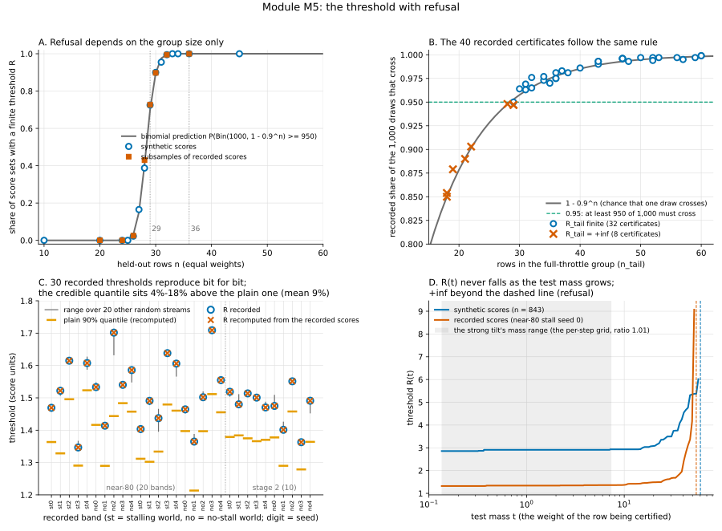

# M5. The threshold, with refusal

**Verdict: works** (the module's own unit tests; the weighting test's mark W0 and the four-learner study's stop rules
S2 and S3 were pre-registered; the 14 synthetic and recorded-data checks below are new and exploratory; the recorded
thresholds and certificates they read come from runs whose rules were pre-registered where section 9 says so).

**The one sentence for the advisor.** *The threshold is the published weighted Bayesian conformal rule; it
reproduces bit for bit on all 30 recorded bands, keeps its 95% promise where the truth is known, and refuses purely by
group size: never at 24 or fewer rows, always from 33.*

**In full:** *BCA's threshold is the published weighted Bayesian conformal rule; it
reproduced bit for bit from the recorded held-out scores on all 30 recorded ThrusterChain bands in the project's pinned
environment, it covers 90% of fresh scores in 96-98% of synthetic calibration sets (the claim is 95%), and it refuses
exactly as the binomial arithmetic predicts (it practically never certifies 24 or fewer held-out rows, practically
always certifies 33 or more, and flips a weighted coin in between), which is why the harm switch's height was infinite
in 8 of 40 recorded seed-worlds, all of them with 18 to 29 full-throttle rows.*

Written 20 October 2026. Code under test: `calibration/wbcp.py:43-117` (used unchanged), `calibration/reference.py:17-29,
124-136, 152-194`, and the callers listed in section 3. Module map: `docs/bca_mechanics/MODULES.md`, section M5.
Reproduction: `docs/bca_mechanics/scripts/M5_test.py` (its printed output is quoted below), the pinned-environment job
`scripts/M5_pinned_job.sh` with its output `data/M5_pinned_output.txt`, and every number behind the tables in
`data/M5_results.json` (Windows run) and `data/M5_pinned_results.json` (pinned run). Figure:
`docs/bca_mechanics/figures/M5.svg`. Nothing was trained for this document; no band was fitted on study data.

---

## 1. What the module does, in plain words

BCA puts an error band around a critic. Modules M1 to M3 turn each **held-out row** (a recorded step kept out of
training) into a **score**: the size of the critic's one-step error on that row, divided by the scale the error-size
network predicted for it. A score of 1 means "as large as predicted". This module takes the list of held-out scores and
returns one number, the **threshold** R. The band's half-width at any row is then R times the predicted scale (module
M6), so R is the one number that sets how wide every band is.

R is chosen so that 90% of fresh scores should fall below it, and so that this holds with **95% credibility** (a
Bayesian statement: given the held-out scores, the chance that fewer than 90% of fresh scores fall below R is at most
5%). The rule is Algorithm 1 of Lou and Luo, *Weighted Bayesian Conformal Prediction* (arXiv:2604.06464v3), which with
equal weights is the Bayesian quantile of Snell and Griffiths (2025). In plain steps:

1. **The plain quantile** λ̂: sort the scores; λ̂ is the smallest score at which the (weighted) count of scores at or
   below it reaches 90% of the total. With 821 equally weighted scores it is the 739th smallest.
2. **The draws**: 1,000 times, give every held-out score a random positive weight (a standard exponential random
   number E_j, times the row's weight w_j), and give one extra "**test atom**" the weight E_{n+1}·t. The test atom stands
   for the unseen row being certified, placed at the worst case (above every score); t is its **test mass** (1 in
   standard BCA). In each draw, the **crossing** is the first sorted score at which the cumulative random mass reaches
   90% of the total random mass, test atom included. If the test atom alone holds more than 10% of the mass, no score
   reaches it and the crossing is +infinity.
3. **The credible quantile** λ_HPD: the 950th smallest of the 1,000 crossings. It is finite only if at least 950 draws
   crossed.
4. **The threshold**: R = max(λ̂, λ_HPD). R = +infinity is **refusal**: "cannot certify". λ_HPD is normally the larger
   one; the gap λ_HPD/λ̂ − 1 is the **Bayesian margin**, the price of the 95% credibility.

**Weights.** Standard BCA gives every held-out row the weight 1 and the test atom the mass 1. When a shift between the
recorded data and the test situation is declared (module M4), each held-out row gets a weight w_j (how much more often
its situation occurs at test time than in the recording) and the row being certified gets its own mass t. Only ratios
matter: the code divides all weights and t by the largest weight. The **Kish effective size** n_eff = (Σw)²/Σw² says
how many equally weighted rows the weighted set is worth.

**The random stream.** The 1,000 draws come from a NumPy random generator seeded from the refresh's random key, so the
same held-out scores and the same key give the same R to the last bit. This is what makes the recorded thresholds
reproducible below.

**Where R is computed.** In co-training (the hosts), at a **refresh**: update 10,000, then every 5,000, 18 times in a
100,000-update run. On a frozen critic (stage 2, the near-80 run), once, after 20,000 fitting steps of the error-size
network. The weighted arms build a **per-step table** R(t) on a grid of test masses t = 1.01^k and read each training
row's threshold at its own mass. The harm switch (module M10) runs the same rule twice, on two groups of residuals,
with no error-size network.

**Why refusal depends on the group size only.** With equal weights, whether a draw crosses does not depend on the
score values at all: the test atom's share of the mass is a Beta(1, n) random variable, and it exceeds 10% with
probability 0.9^n. So each draw crosses with probability 1 − 0.9^n, the number of crossing draws is
Binomial(1000, 1 − 0.9^n), and R is finite exactly when that number is at least 950. The chance of a finite R is
therefore P(Binomial(1000, 1 − 0.9^n) ≥ 950): below 1e-5 at n ≤ 23, 0.0001 at 24, 0.003 at 25, 0.031 at 26, 0.150 at
27, 0.405 at 28, 0.700 at 29, 0.896 at 30, 0.976 at 31, 0.996 at 32, 0.9995 at 33, 0.99996 at 34, and 1 to within 1e-6
from n = 35 (within 1.2e-7 from 36, the bar `calibration/reference.py:124-136`, `certifiable`, uses). The exact,
infinitely-many-draws form of the rule is finite only when 0.9^n ≤ 0.05, that is n ≥ 29.

---

## 2. What "works as intended" means (checkable statements)

- **C1, the rule.** R equals the published rule on the recorded inputs: the plain quantile is the ceil(0.9·n)-th smallest
  score, the credible quantile is the 950th smallest crossing, R is the larger, and the recorded R, λ̂, λ_HPD, n_eff and
  σ_post (the spread of the crossings) are reproduced bit for bit from the recorded held-out scores and the recorded
  key, in the project's pinned environment.
- **C2, credibility.** On exchangeable scores from a known law, the threshold covers at least 90% of the population in
  about 95% of calibration sets (the plain quantile alone would do so in about 50%).
- **C3, refusal.** The share of score sets with a finite R equals P(Binomial(1000, 1 − 0.9^n) ≥ 950) at every group
  size n, on synthetic and on recorded scores; every recorded certificate's refusal follows the same rule.
- **C4, identities.** Weights of 1 with test mass 1 give the standard threshold bit for bit; a common factor on the
  weights and the test mass changes nothing; decisions agree with the exact binomial form of the rule.
- **C5, the per-step table.** R(t) never falls as the test mass t grows (the lookup "round the mass up to the grid"
  depends on it).
- **C6, the schedule.** Every scheduled refresh on record certified (no silent refusal in co-training), and the
  recorded stop rules that re-derive R from the held-out scores held at every refresh.

---

## 3. Pseudocode, labeled (from MODULES.md, with corrections and additions marked)

Source: `calibration/wbcp.py:57-117` (calibrate) and `:43-54` (crossings); `calibration/reference.py:152-194`
(freeze_reference) and `:124-136` (certifiable); the posterior key `algorithms/td3_bc_bca.py:268`; the schedule
`experiments/shift/learners.py:1162-1164` and the refresh call `:1217-1222`; the per-step table
`experiments/shift_iw/coverage.py:153-205` and its callers `learners_iw.py:939-952` and
`experiments/shift_hosts/iw.py:461-522` (branch `claude/shift-hosts`); the frozen-critic key rule
`outputs/shift/beyond-the-data/stage2/code/band.py:243-248`; stage 2's fallback table `band.py:333-357`; the harm
switch's posteriors `restructure/step1/step1lib.py:237-241`. Copied from MODULES.md M5 and extended; changes are marked.

```
1  [M5.1 sort]           sort the scores ascending; carry the weights along; divide weights and t by max w
                         (wbcp.py:83-87; with no weights given, every w = 1 and t = 1, wbcp.py:66-69)
2  [M5.2 plain quantile] lambda_hat = the smallest sorted score at which the cumulative weight >= 0.9 * total weight
                         (ties count as covered; settled in exact rationals, wbcp.py:89-102)
3  [M5.3 draws]          for m = 1..1000: E_1..E_n, E_{n+1} ~ Exponential(1) from the posterior stream
                         [ADDED: the stream] the stream is numpy's default_rng seeded with the 32-bit words of
                         fold_in(refresh key, 1347375956) (td3_bc_bca.py:268; reference.py:177); the refresh key is
                         fold_in(PRNGKey(refresh_seed), update) in co-training (learners.py:1197, 1218) and
                         fold_in(PRNGKey(default_rng([20261015, seed, 41, 1]).integers(2^31 - 1)), 20000) on a frozen
                         critic (band.py:243-248; v6bca.py:57)
4  [M5.4 crossing]       lambda^(m) = the first sorted score k with sum_{j<=k} E_j w_j >= 0.9 (sum_j E_j w_j + E_{n+1} t);
                         +infinity if no k reaches it (the test atom alone holds more than 10% of the mass) (wbcp.py:43-54)
5  [M5.5 credible]       lambda_HPD = the 950th smallest of the 1,000 crossings   (ceil(0.95 * 1000); wbcp.py:115)
6  [M5.6 threshold]      R = max(lambda_hat, lambda_HPD); R = +infinity means refusal ("cannot certify") (wbcp.py:117)
7  [M5.7 store]          store R, lambda_hat, lambda_HPD, n_eff in float32 with eta_f and u_f (reference.py:184-188);
                         [CORRECTED] a finite R that overflows float32 does not refuse: it makes the refresh INVALID,
                         and an invalid refresh keeps the previous reference unchanged (reference.py:181-183;
                         td3_bc_bca.py:272, 276); diagnostics also keep sigma_post (the spread of the crossings,
                         +infinity if any crossing is infinite) and clamp_binds (lambda_hat > lambda_HPD) (reference.py:189-193)
8  [M5.8 schedule]       co-training: refresh at update 10,000, then every 5,000, last at 95,000 of 100,000
                         (18 refreshes; learners.py:1162-1164 with warmup 10,000 and refresh_every 5,000, learners.py:104);
                         on a frozen critic: 20,000 fit steps, then one refresh (band.py:89 BAND_FIT_STEPS; v6bca.py:56-57)
9  [M5.9 per-step table] with weights: R(t) at every grid mass t = 1.01^k from the largest grid mass at most the smallest
                         mass looked up to the smallest grid mass at least the largest (coverage.py:153-170), the same
                         stream for every t (coverage.py:173-186); a row or step reads R at the smallest grid mass >= its
                         own mass (coverage.py:196-205); the table stores the running maximum of R(t) and records whether
                         it changed anything (monotone, running_max_applied); [ADDED] a mass beyond the grid is an error,
                         not a refusal (coverage.py:203-204), so the grid is built on every mass that will be looked up
10 [M5.10 certificate]   [ADDED] the harm switch: the same calibrate twice, on the full-throttle group's scores and on
                         the rest, equal weights, rng = default_rng(tags) (step1lib.py:237-241); R_tail - R_rest is the
                         height (step1lib.py:271); refusal of the small group makes the height +infinity
11 [M5.11 fallback]      [ADDED, built but never used for a claim] stage 2's weighted band: R(t) at 48 masses, evenly
                         spaced in log t from (smallest log weight - 1) to the closed-form refusal point
                         log(0.1/0.9 * sum w) + 3, each with a fresh generator from the same seed; +infinity replaced by
                         the largest finite R (R_c); the first infinite mass is the refusal edge l* (band.py:333-357)
```

Corrections to MODULES.md's M5 text: (i) line 7, as marked: a float32 overflow of a finite R is an *invalid refresh*
(previous reference kept), not a refusal; (ii) MODULES.md lists the outputs as "R, λ̂, λ_HPD, the 1,000 crossings,
n_eff"; the stored record also carries σ_post and clamp_binds, and the band records read below store the refresh block
in float64 and the deployed block in float32 (both reproduced); (iii) the per-step grid is built from the masses that
will be looked up, not from "the smallest to the largest mass looked up" alone: its ends are powers of 1.01 that bracket
them.

---

## 4. Synthetic tests: the truth is known

`M5_test.py` Part 1 runs the repository's own `wbcp.calibrate` on synthetic scores. Every number here was printed by
both environments (the pinned one and the Windows venv) and is identical in both, because the synthetic scores are
seeded.

**Table S1. Refusal by group size (C3).** 400 random score sets per size with equal weights; "predicted" is
P(Binomial(1000, 1 − 0.9^n) ≥ 950). The two right-hand columns come from Part 2: subsamples drawn without replacement
from a recorded score set (400 per size; near-80 stalling world seed 0, 821 scores; no-stall seed 0, 823), and the 40
recorded certificates (the number with a finite R_tail over the number with that group size).

| held-out rows n | predicted finite | synthetic, finite | recorded scores, stall | recorded scores, no-stall | exact form | recorded certificates, finite / all |
|---|---|---|---|---|---|---|
| 10 | 0.000 | 0.000 | | | +inf | |
| 18-22 | 0.000 | | | | +inf | 0 / 5 |
| 20 | 0.000 | 0.000 | 0.000 | 0.000 | +inf | |
| 24 | 0.0001 | 0.000 | 0.000 | 0.000 | +inf | |
| 25 | 0.003 | 0.000 | | | +inf | |
| 26 | 0.031 | 0.022 | 0.025 | 0.032 | +inf | |
| 27 | 0.150 | 0.165 | | | +inf | |
| 28 | 0.405 | 0.388 | 0.430 | 0.425 | +inf | 0 / 1 |
| 29 | 0.700 | 0.725 | 0.728 | 0.738 | finite | 1 / 3 |
| 30 | 0.896 | 0.900 | 0.898 | 0.895 | finite | 1 / 1 |
| 31 | 0.976 | 0.955 | | | finite | 2 / 2 |
| 32 | 0.996 | 0.995 | 0.995 | 0.995 | finite | 2 / 2 |
| 33-34 | 1.000 | 1.000 | | | finite | 3 / 3 |
| 36 | 1.000 | 1.000 | 1.000 | 1.000 | finite | 3 / 3 |
| 45, 100 | 1.000 | 1.000 | | | finite | |
| 35-60 (all) | 1.000 | | | | finite | 27 / 27 |

Every synthetic and subsample share is within three binomial standard errors of its prediction (check 1a and 2c, both
PASS); the observed share is 0 at n ≤ 24 and 1 at n ≥ 33 in every column (the prediction there is 1 in 7,000 and
1 refusal in 2,000). Refusal is a property of the number of rows and the random draws, not of the critic or the scores.

**Table S2. The 95% credibility claim (C2).** 400 calibration sets per size of Exponential(1) scores, whose true 90%
quantile is ln 10 = 2.303; "true coverage" of a threshold is the share of the whole population below it (check 1b,
PASS).

| n | sets with a finite R | true coverage ≥ 90% with R | with the plain quantile alone | mean true coverage, R / plain | R ÷ true 90% quantile | R is the single largest score |
|---|---|---|---|---|---|---|
| 36 | 100% | 98.0% | 49.8% | 0.972 / 0.892 | 1.803 | 100% |
| 100 | 100% | 95.8% | 41.8% | 0.948 / 0.890 | 1.337 | 0% |
| 843 | 100% | 97.0% | 51.7% | 0.918 / 0.900 | 1.087 | 0% |

The credibility claim holds (95.8% to 98.0% against the promised 95%), and it is the credible quantile that delivers
it: the plain 90% quantile alone covers 90% only about half the time. The price is width: at 843 scores R sits 8.7%
above the true 90% quantile and covers 91.8% of the population; at 36 scores R is the largest held-out score and covers
97.2%.

**Table S3. Chance in the draws and the exact form (C4).** Left: one fixed score set per size, recomputed with 50
random streams (check 1c). Right: 300 random sets per size; "decisions agree" means the 1,000-draw threshold and the
infinite-draw binomial form fall on the same side of a random claimed value (check 1e). Both PASS.

| n | R over 50 streams, max/min − 1 | streams that hit the exact form | decisions agree (300 sets) | values equal |
|---|---|---|---|---|
| 36 | 0.000 | 100% | 100.0% | 100.0% |
| 45 | 0.070 | 64% | 93.7% | 59.7% |
| 100 | 0.033 | 92% | 99.3% | 84.7% |
| 843 | 0.023 | 52% | 100.0% | 59.7% |

With 29 to 45 scores the exact credible threshold is the single largest score, and from 46 up it moves to the second,
third, ... largest; near each such step the 1,000 draws can land on either side, which is where the stream-to-stream
movement comes from. At 843 scores the movement is 2.3% for this set and at most 4.1% on the recorded sets (Table R1).

**Table S4. Weights (C4, C5) and the advisor's weighting question at the threshold level.** Checks 1d, 1f, 1g, all PASS.
The weights are the strong tilt's exact shape w(c) = 0.0907·e^{4c} (the weighting test's strong shift,
`experiments/shift_iw/world.py:128-135`) on a synthetic current c ~ Uniform(0.1, 1.1); the synthetic scores do not depend
on c, so the weights carry no information about them.

| check | result |
|---|---|
| weights of 1, test mass 1: identical to unweighted (R, λ̂, λ_HPD and all 1,000 crossings), 40 random sets | 40 of 40 |
| a common factor of 1,000 on weights and test mass: identical R and crossings, 40 sets | 40 of 40 |
| R(t) along the per-step grid, 402 masses from 0.135 to 7.39 (ratio 1.01) and 101 more up to t = 1,000 (ratio 1.05), 843 scores | never falls; R(1) = 2.912, R(0.135) = 2.857, R(7.39) = 2.934 |
| first infinite R(t) | t = 60.2 (the closed-form point at which the test atom alone averages 10% is 162.4); Kish effective size 392 of 843 |
| 60 sets of 843 exchangeable scores, weighted (one test mass = mean weight) against unweighted: R_w / R_u | mean 1.030, from 0.939 to 1.197, above 1 in 77% of sets; plain weighted / plain unweighted quantile: 1.000 |
| the same: Bayesian margin λ_HPD/λ̂ − 1 | 11.8% weighted against 8.4% unweighted (Kish effective size 404 of 843) |
| the same: true coverage ≥ 90% | 96.7% of sets weighted, 93.3% unweighted; mean true coverage 0.923 against 0.918 |

So on data with no real shift, declaring one makes the threshold 3% wider on average, entirely through the Bayesian
margin on the smaller effective sample (the plain quantiles agree to four digits), and the weighted threshold stays
valid. The spread (0.94 to 1.20 on single sets) is what the weighting test saw with *estimated* weights under its
no-shift law (section 6).

---

## 5. Real-data tests: the recorded ThrusterChain inputs

`M5_test.py` Part 2 reads records only. The 30 recorded bands are version 6 of BCA fitted on a frozen critic
(`runs/shift_explore/near80/learners/<setting>/<world>/seed<k>/{v6_band.json, v6_bank_scores.npz}` for the near-80 run,
also on branch `claude/near80-run-files`; `runs/shift_explore/stage2/detect/uniform/<world>/fixed/seed<k>/{band.json,
bank_scores.npz}` for stage 2, in the owner's WSL clone). Each record stores the held-out scores exactly as the refresh
computed them (float64) and the refresh's R, λ̂, λ_HPD, n_eff and σ_post. The near-80 run has two removals: **near-80**
(the ball, the densest 15% of recorded commands, plus every command with a throttle of 70-90%) and **random rows** (the
ball plus as many randomly chosen rows as the near-80 removal takes, drawn from the same kinds of water; the control).
Stage 2's bands use the ball only ("gap"). The pinned environment (Python 3.10.20, NumPy 2.2.6, JAX 0.6.2) produced
the table; the Windows venv (Python 3.14.2, NumPy 2.5.4, JAX 0.12.0) gave the same 30 thresholds to the last bit.

**Table R1. The 30 recorded thresholds, recomputed from the recorded scores with the recorded key (C1).**
"margin" = λ_HPD/λ̂ − 1; "share ≤ R" = the share of the held-out scores at or below R (in-sample); "eq" = the recomputed
R, λ̂, λ_HPD, n_eff and σ_post equal the record in float64, and R equals the deployed float32 value (check 2a, 30 of 30).

| band | world | seed | rows | plain λ̂ | credible λ_HPD | R recorded | R recomputed | eq | margin | share ≤ R | share ≤ λ̂ |
|---|---|---|---|---|---|---|---|---|---|---|---|
| near-80 | stall | 0 | 821 | 1.3634 | 1.4692 | 1.469181 | 1.469181 | yes | 7.8% | 0.918 | 0.900 |
| near-80 | stall | 1 | 814 | 1.3283 | 1.5219 | 1.521924 | 1.521924 | yes | 14.6% | 0.919 | 0.900 |
| near-80 | stall | 2 | 806 | 1.4957 | 1.6148 | 1.614827 | 1.614827 | yes | 8.0% | 0.918 | 0.901 |
| near-80 | stall | 3 | 826 | 1.2905 | 1.3466 | 1.346607 | 1.346607 | yes | 4.3% | 0.918 | 0.901 |
| near-80 | stall | 4 | 805 | 1.5234 | 1.6075 | 1.607509 | 1.607509 | yes | 5.5% | 0.919 | 0.901 |
| near-80 | no-stall | 0 | 823 | 1.4164 | 1.5332 | 1.533197 | 1.533197 | yes | 8.2% | 0.917 | 0.900 |
| near-80 | no-stall | 1 | 820 | 1.2898 | 1.4138 | 1.413837 | 1.413837 | yes | 9.6% | 0.918 | 0.900 |
| near-80 | no-stall | 2 | 814 | 1.4436 | 1.7016 | 1.701579 | 1.701579 | yes | 17.9% | 0.918 | 0.900 |
| near-80 | no-stall | 3 | 832 | 1.4835 | 1.5402 | 1.540164 | 1.540164 | yes | 3.8% | 0.918 | 0.900 |
| near-80 | no-stall | 4 | 808 | 1.4573 | 1.5858 | 1.585784 | 1.585784 | yes | 8.8% | 0.918 | 0.901 |
| random rows | stall | 0 | 821 | 1.3116 | 1.4035 | 1.403463 | 1.403463 | yes | 7.0% | 0.918 | 0.900 |
| random rows | stall | 1 | 814 | 1.3023 | 1.4907 | 1.490732 | 1.490732 | yes | 14.5% | 0.919 | 0.900 |
| random rows | stall | 2 | 806 | 1.3338 | 1.4372 | 1.437162 | 1.437162 | yes | 7.7% | 0.918 | 0.901 |
| random rows | stall | 3 | 826 | 1.4794 | 1.6382 | 1.638179 | 1.638179 | yes | 10.7% | 0.918 | 0.901 |
| random rows | stall | 4 | 805 | 1.4603 | 1.6058 | 1.605837 | 1.605837 | yes | 10.0% | 0.919 | 0.901 |
| random rows | no-stall | 0 | 823 | 1.3972 | 1.4644 | 1.464448 | 1.464448 | yes | 4.8% | 0.917 | 0.900 |
| random rows | no-stall | 1 | 820 | 1.2133 | 1.3647 | 1.364692 | 1.364692 | yes | 12.5% | 0.918 | 0.900 |
| random rows | no-stall | 2 | 814 | 1.3968 | 1.5019 | 1.501868 | 1.501868 | yes | 7.5% | 0.918 | 0.900 |
| random rows | no-stall | 3 | 832 | 1.5115 | 1.7091 | 1.709077 | 1.709077 | yes | 13.1% | 0.918 | 0.900 |
| random rows | no-stall | 4 | 808 | 1.4553 | 1.5547 | 1.554708 | 1.554708 | yes | 6.8% | 0.918 | 0.901 |
| stage 2 | stall | 0 | 851 | 1.3791 | 1.5188 | 1.518778 | 1.518778 | yes | 10.1% | 0.919 | 0.900 |
| stage 2 | stall | 1 | 848 | 1.3839 | 1.4799 | 1.479896 | 1.479896 | yes | 6.9% | 0.916 | 0.901 |
| stage 2 | stall | 2 | 839 | 1.3748 | 1.5137 | 1.513720 | 1.513720 | yes | 10.1% | 0.918 | 0.901 |
| stage 2 | stall | 3 | 851 | 1.3660 | 1.5007 | 1.500716 | 1.500716 | yes | 9.9% | 0.918 | 0.900 |
| stage 2 | stall | 4 | 827 | 1.3702 | 1.4703 | 1.470309 | 1.470309 | yes | 7.3% | 0.918 | 0.901 |
| stage 2 | no-stall | 0 | 850 | 1.3776 | 1.4750 | 1.474976 | 1.474976 | yes | 7.1% | 0.918 | 0.900 |
| stage 2 | no-stall | 1 | 845 | 1.2899 | 1.4012 | 1.401187 | 1.401187 | yes | 8.6% | 0.918 | 0.901 |
| stage 2 | no-stall | 2 | 838 | 1.4578 | 1.5511 | 1.551117 | 1.551117 | yes | 6.4% | 0.918 | 0.901 |
| stage 2 | no-stall | 3 | 850 | 1.2787 | 1.3629 | 1.362860 | 1.362860 | yes | 6.6% | 0.918 | 0.900 |
| stage 2 | no-stall | 4 | 829 | 1.3640 | 1.4910 | 1.491011 | 1.491011 | yes | 9.3% | 0.919 | 0.901 |

What the table shows. (a) All 30 reproduce bit for bit in float64 and float32 (C1 holds), and in every band the plain
quantile is the independent order statistic (the ceil(0.9·n)-th smallest score) and the credible quantile the 950th
smallest crossing; all 1,000 crossings were finite in every band. (b) The credible quantile was the binding one in 30
of 30; the Bayesian margin is 3.8% to 17.9%, mean 8.9%, the same size as on synthetic data at n ≈ 843 (8.7%, Table S2).
(c) In-sample, R sits above 91.6-91.9% of the held-out scores and the plain quantile above 90.0-90.1% (by construction);
out-of-sample coverage is module M6's business. (d) The thresholds (1.35 to 1.71) differ by removal and world by less
than the Bayesian margin's own range: the near-80 removal does not move R relative to its random-rows control (stall:
mean 1.512 against 1.515; no-stall: 1.555 against 1.519). (e) Recomputing each band with 20 other random streams moved
R by at most 4.1% (check 2b, PASS): at 805-851 held-out rows the draws contribute a few percent of chance to R.

**Table R2. The 40 recorded certificates (C3 on the harm switch).** From `outputs/shift/beyond-the-data/near80/
results-20261020T115246Z/files/learners/*/*/seed*/switch.json` (30) and `restructure/step1/results/results.json` (10).
Each certificate ran this module on the full-throttle group (n_tail rows) and on the rest (803-878 rows) and recorded
the share of the 1,000 draws that crossed. Check 2d, PASS: the recorded share was within three binomial standard errors
of 1 − 0.9^n in 40 of 40; R_tail was finite exactly when at least 950 draws crossed in 40 of 40; every draw crossed in
the rest group in 40 of 40.

| group size n_tail | certificates | share of draws crossing, recorded (1 − 0.9^n) | R_tail |
|---|---|---|---|
| 18 (main, fresh seeds 10 and 13) | 2 | 0.854, 0.850 (0.850) | +inf, +inf |
| 19 (main, seed 10, stalling) | 1 | 0.879 (0.865) | +inf |
| 21, 22 (main, seed 12) | 2 | 0.890, 0.903 (0.891, 0.902) | +inf, +inf |
| 28 (random rows, no-stall seed 3) | 1 | 0.948 (0.948) | +inf |
| 29 (three certificates) | 3 | 0.947, 0.947, 0.950 (0.953) | +inf, +inf, 5.591 |
| 30-32 | 5 | 0.963-0.976 (0.958-0.966) | finite, 0.107 to 4.564 |
| 34-60 | 26 | 0.970-0.999 (0.972-0.998) | finite, 0.024 to 5.986 |

The 8 infinite heights are all and only the groups where fewer than 950 draws crossed. At n = 29 one certificate was
certified and two refused, but the two refusals are one random draw counted twice: both runs tag the posterior with
[20261015, 9700, seed, world, 1] and whether a draw crosses depends only on the exponentials, not on the scores, so
step 1's no-stall seed 3 and the near-80 setting's no-stall seed 3 (both 29 rows, both finite share 0.947) are the same
1,000 draws applied to two score vectors. The record therefore holds two independent 29-row draws, one certified
(random rows, stall, seed 0; finite share 0.950) and one refused, in line with the 70/30 chance of Table S1; refusal is
a deterministic function of (seed, world, group size), predictable before any critic is read. Three of the refusals
are the stops on fresh seeds 10, 12 and 13
of the main setting (`policy/main/stall/seed{10,12,13}/stop.json`): switch on, height infinite. That is the "exceptional
case" of the advisor's brief, and it is this module's arithmetic, not the critic.

**Table R3. The refresh schedule on record (C6).** Check 2e (the weighting test's exploratory rerun, seed 0, five data
qualities, standard and strong-weighted arms; `outputs/shift_iw/explore/routes2/diagnose/dose_chunks.json`) and check
2f (the four-learner study, `origin/claude/shift-hosts:outputs/shift_hosts_v3/results.json`). Both PASS.

| record | runs | refreshes per run | certified | first refresh identical across arms | stop rule S3 |
|---|---|---|---|---|---|
| weighting test, co-training (TD3+BC) | 10 (5 qualities × 2 arms) | 18 (update 10,000, then every 5,000) | 18 of 18 in all 10; thresholds 1.10 to 1.56 over training | yes, 5 of 5 qualities | not recorded here |
| four-learner study, standard and weighted arms (CQL, ReBRAC, TD3+BC; medium and medium-expert) | 35 | 18 | 18 of 18 in all 35 | | 270 of 270 refreshes of the 15 weighted runs the record reports in full reproduced the standard threshold bit for bit from the held-out scores (the record's own export counts 288 refreshes checked, none not reproduced, over 16 runs; it gives no per-run breakdown) |

No scheduled refresh ever refused with about 840 held-out rows, as the arithmetic requires (Table S1: the chance of
refusal is below 1e-6 from 36 rows up). The unweighted threshold in co-training drifted between 1.10 and 1.56 as the
critic trained; the two arms of a quality were identical until the first refresh (the same first threshold), after which
the weighted arm's training rows see different doses.

**R(t) on recorded scores (C5).** Check 2g (mechanics only: the strong tilt's weight shape on a synthetic current, since
the real weights of these bands were never built): on the 821 scores of the near-80 stalling world seed 0, R(t) never
fell along the 503-point grid; R(1) = 1.340, R(7.39) = 1.361, first +infinity at t = 54.6 (closed-form point 162.1),
Kish effective size 389 of 821. PASS.

---

## 6. The threshold under weights, on record (the advisor's "IW: is the weighting right?")

This module changes nothing about *which* weights are used (module M4); it only turns weights into a threshold. What
the records say about that step, read from `outputs/shift_iw/v5/<quality>/report.json` on branch `main`
(`marks.W0.per_seed` and `shown.R_weighted_over_R_unweighted.gap.single.{exact_none_single, estimated_none_single,
exact_mild_single, exact_strong_single}`, each with `mean` over seeds 0-4 and `per_seed`; the qualities in the order
random, medium-replay, medium, medium-expert, expert):

| condition (weighting test, version 5, five seeds per quality) | R_weighted / R_unweighted | consistent or exceptional |
|---|---|---|
| exact weights for the no-shift law (all 1) | 1.0000 on 25 of 25 quality-seeds (mark W0, pre-registered; bit for bit) | consistent: with no declared shift the weighted threshold *is* the standard one |
| estimated weights fitted for the no-shift law | means 1.009, 0.999, 1.005, 0.994, 1.000 by quality; single seeds 0.913 to 1.050 | exceptional: classifier noise around a slope that should be 0; the synthetic Table S4 shows the same spread (0.94-1.20) from the smaller effective sample alone |
| exact weights, mild shift | 1.10, 1.08, 1.16, 1.26, 1.13 by quality (1.03 to 1.35 per seed) | consistent: up on all 25 seeds |
| exact weights, strong shift | 1.23, 1.20, 1.35, 1.76, 1.45 by quality (1.11 to 2.25 per seed) | consistent: up on all 25 seeds, by construction, because the heavy rows are the high-current rows where the critic's scores are larger |

So the answer at this module's level: IW gives a higher threshold than standard under no shift *only* by the
few-percent chance of the Bayesian margin on a smaller effective sample (never when the weights are exactly 1), and it
gives a higher threshold under a declared shift *always*. Whether the resulting penalty is right is module M7's and
M9's question; whether the weights themselves are right is M4's.

---

## 7. The figure (`figures/M5.svg`)



Four panels. **A.** The share of score sets with a finite threshold against the number of held-out rows: the binomial
prediction (gray curve), synthetic scores (blue circles) and subsamples of recorded scores (orange squares) lie on one
curve, 0 at n ≤ 24, 1 from 33; dotted lines at 29 (the exact form's edge) and 36 (`certifiable`'s edge). **B.** The 40
recorded certificates: the recorded share of crossing draws in the full-throttle group against its size, on the curve
1 − 0.9^n; the dashed line at 0.95 separates the 8 refusals (orange crosses) from the 32 finite heights (blue circles).
**C.** The 30 recorded thresholds (blue circles) with the recomputed values (orange crosses, on top of them), the plain
90% quantile (orange dashes) below each, and the range of R over 20 other random streams (gray bars). **D.** R(t) along
the test-mass grid for synthetic scores (blue) and the recorded scores of the near-80 stalling world seed 0 (orange):
flat across the strong tilt's mass range (shaded), rising near the refusal point, +infinity beyond the dashed line.
Colors are the Okabe-Ito set (colorblind-safe).

---

## 8. Consistent and exceptional cases (for debugging)

**Consistent (every record).**
1. The threshold reproduces bit for bit from the recorded scores and key: 30 of 30 bands (two environments), 270 of 270
   four-learner refreshes (stop rule S3), `threshold_recomputed.equal` true in every band record.
2. The credible quantile binds, never the plain one: 30 of 30 bands; margin 4-18% (mean 9%) at 805-851 rows.
3. Weights of 1 give the standard threshold exactly: W0 25 of 25, S2, 40 of 40 synthetic sets.
4. No refresh refuses at about 840 rows: 18 of 18 in all 45 co-training runs on record.
5. Refusal follows the binomial curve on every group size tested: 40 of 40 certificates, 16 synthetic sizes, 8 subsample
   sizes on two recorded score sets.

**Exceptional (few records; the cases to show the advisor).**
6. *Refusal of a small group.* 8 of 40 certificates (group sizes 18-29), including the three stops on fresh seeds 10,
   12 and 13. To reproduce: subsample any recorded score set to n rows and count finite thresholds (`M5_test.py` check
   2c), or read `switch.json`'s `finite_share_tail` against 0.95.
7. *Chance in the small-group threshold.* With 29-45 scores R is the largest score; between random streams the
   1,000-draw R can sit one order statistic lower (7% for one set of 45, up to 44% in `threshold_checks.py` check 3), so
   certificate heights at 29-60 rows carry chance from the draws as well as from the data. The exact form (section 1)
   removes the stream dependence; it was not the rule the runs used.
8. *The weighted threshold under no shift.* Single seeds move by −9% to +5% with estimated weights (section 6); on
   synthetic exchangeable data the same spread appears from the effective sample size alone (Table S4).
9. *The silent invalid refresh* (pseudocode line 7): a refresh with non-finite inputs or an overflowing R keeps the
   previous threshold and reports `posterior_inputs_valid: false`. None occurred in the records read here (every refresh
   certified), so this path is unit-tested only.

---

## 9. Verdict, labels, and what to say

**Verdict: works.**

**Summary for the meeting.** *BCA's threshold is the published weighted Bayesian conformal rule, implemented so
that the same held-out scores and random key give the same number to the last bit; we re-derived all 30 recorded
ThrusterChain thresholds that way. On synthetic data where the truth is known it keeps its 95% promise (coverage of
90% in 96-98% of calibration sets), and its one surprising behavior, refusing to certify small groups, is pure
arithmetic: with 1,000 draws it practically never certifies 24 or fewer rows (1 in 7,000), practically always certifies
33 or more (1 refusal in 2,000), and flips a weighted coin in between, which is exactly what the 8 infinite harm-switch
heights on record are.*

**Labels.** *Pre-registered*: W0 (weights of 1 reproduce the standard threshold; weighting test, 25 of 25); the
four-learner stop rules S2 and S3 (pre-specification version 3; 270 of 270); the near-80 certificates of fresh seeds
10-14 (the rule was frozen before the run; the infinite heights stopped it by its own rule). *Exploratory*: the
weighting test's co-training rerun (seed 0) read in check 2e; step 1's certificates (seeds 0-4). *Description only /
new*: the 14 checks of `M5_test.py`, the 15 unit tests of `experiments/wbcp/test_wbcp.py` (all pass in the pinned
environment, `data/M5_pinned_output.txt`), and the pseudocode block.

**Caveats that belong to other modules, stated once.** The threshold is as good as its scores: if the scores are not
exchangeable with the fresh rows (a shift that is not declared, or dependence within episodes), the 90% promise is
about the held-out population, not the test one; that is M3, M4 and M6's territory. Refusal is a statement about the
group size, not about the critic.

---

## 10. Reproduction

- `docs/bca_mechanics/scripts/M5_test.py`: both parts, the figure and the table file. Windows venv (Python 3.14.2,
  NumPy 2.5.4, JAX 0.12.0, Matplotlib 3.11.2), from the worktree root with `PYTHONPATH=M:\` and
  `PYTHONDONTWRITEBYTECODE=1`:
  `python docs\bca_mechanics\scripts\M5_test.py --root M:\ --figure docs\bca_mechanics\figures\M5.svg --json
  docs\bca_mechanics\data\M5_results.json --near80-root \\wsl.localhost\Ubuntu-24.04\home\user\bca\runs\shift_explore\near80
  --stage2-root \\wsl.localhost\Ubuntu-24.04\home\user\bca\runs\shift_explore\stage2` (56 s; all 14 checks PASS).
  Without `--near80-root` the near-80 files are fetched with `git show origin/claude/near80-run-files:<path>`; the
  stage-2 run files exist only in the owner's WSL clone.
- `docs/bca_mechanics/scripts/M5_pinned_job.sh`: the same script in the pinned environment (Python 3.10.20, NumPy
  2.2.6, JAX 0.6.2, SciPy 1.15.3) through the owner's WSL bridge, plus `python -m unittest -v
  experiments.wbcp.test_wbcp`. Output: `docs/bca_mechanics/data/M5_pinned_output.txt` (72 s; 13 checks PASS, check 2f
  skipped there because the owner's clone cannot reach the shift-hosts branch; 15 unit tests OK; input checksums of the
  score files printed at the top). Table file: `data/M5_pinned_results.json`.
- `docs/bca_mechanics/scripts/threshold_checks.py` and `certificate_table.py`: the earlier, smaller checks quoted in
  MODULES.md (their numbers agree with the tables above).
- The records: section 5 names each file; the band records' own `uniform.threshold_recomputed` block already stores
  that the float64 recompute equals the float32 deployed value.
