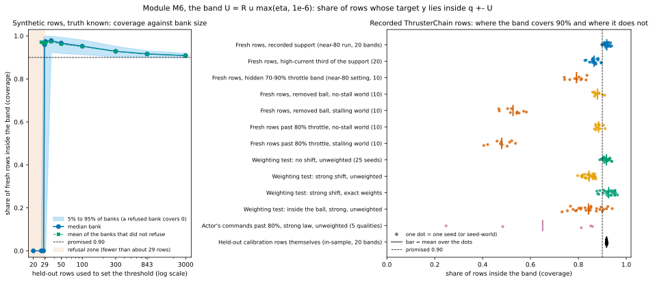

# M6. The band

**Verdict: works with a caveat.** (The width is the formula, bit for bit; the coverage promise is pre-registered and
met in the weighting test (weighting-test marks WT-M1, W1, W2 on all five data qualities; the weighting test's marks
M1-M3 are pass/fail rules, not modules M1-M3) and met again, in a new check, on 20 of 20
saved ThrusterChain bands at rows they never saw. The caveat has three parts, all measured below: the band is a band on
the critic's own one-step target, it holds on average over rows, and where the recorded data stop it is only as good
as the critic's guess.)

**The one sentence for the advisor.** *The band covers 89-94% of fresh rows from the recorded situations in every
band, but it is a band on the critic's one-step target, it holds only on average, and where the data stop it is as
wrong as the critic: half the removed commands in the stalling world.*

**In full:** *The band does what it promises wherever it can be checked: on fresh rows from the
recorded situations it covers 89-94% of targets in every one of 20 saved ThrusterChain bands and 25 weighting-test seeds,
and the weighted band keeps 90% under a declared shift; but it is a band on the critic's one-step target rather than on
the true value, it holds on average (high-current rows 0.87, low-current rows 0.94), and where the recorded data stop it
says nothing reliable: in the stalling world it covers only half of the removed commands, while in the no-stall world
it covers 88% of the same commands, so its failures track the physics the critic never saw, not the width.*

Written 20 October 2026. Code: `calibration/dose.py:65-95` (width, lines 75-76), `calibration/network.py:40-41`,
`experiments/shift_iw/coverage.py:100-105, 262-273, 290-303`, `experiments/shift_iw/learners_iw.py:632-652, 686-716`,
`outputs/shift/beyond-the-data/stage2/code/band.py:153-158`, `outputs/shift/beyond-the-data/near80/code/v6bca.py:90-93`.
Module map: `docs/bca_mechanics/MODULES.md`, section M6. Reproduction: `docs/bca_mechanics/scripts/M6_test.py` (its
printed output is quoted below) and, for the one computation that needs the project's pinned environment,
`docs/bca_mechanics/scripts/M6_fresh_rows.py` with its job file `M6_fresh_rows.sh`; that job's output is
`docs/bca_mechanics/data/M6_fresh_rows_coverage.json`. Figure: `docs/bca_mechanics/figures/M6.svg`. Nothing was trained
for this document; every network was read from disk and only forward passes ran.

---

## 1. What the module does, in plain words

BCA puts an error band around a **critic**, the learned estimate q of how much return a command earns from a state.
The band is q − U to q + U. **U** is the **half-width** ("the width" below). Module M6 is the two lines that make the
width from the parts the earlier modules built, and the rule that says whether a row is inside the band:

    U(s, a) = R · u_f · max(η_f(s, a), 1e-6)
    covered when   q − U ≤ y ≤ q + U

- **R** is the **threshold** (module M5): the score below which 90% of the held-out rows' scores fall, with 95%
  credibility. R = +infinity is a **refusal** ("cannot certify").
- **u_f** is the **unit** (module M2): a running scale of the critic's one-step error, in critic value units, frozen at
  the last refresh.
- **η_f(s, a)** is the **error-size network** (module M2), a small network that says how large the error should be at
  this state and command, as a multiple of the unit; also frozen. The floor 1e-6 only keeps the width from being 0.
- **y** is the **target**: the one-step value the host trains its critic toward, reward plus the discounted target
  critic's value at the next recorded state. **q − U ≤ y ≤ q + U** is the same as |y − q| ≤ U.
- **Coverage** of a group of rows is the share of its rows that are covered. A refused row counts as not covered.
- **Held-out rows** are the rows the threshold was set on (the code calls them "the bank": about 800-850 rows, 5 from
  each of 200 held-out episodes). **Fresh rows** are rows neither the critic nor the band ever saw.

The promise, in one line: on fresh rows from the same situations as the held-out rows, about 90% should fall inside the
band. The width itself is in critic value units (0.24 to 0.30 at a typical ThrusterChain row, section 5, B1).

**Where the width is read.** At the recorded state and command of held-out or test rows (coverage, this module); at the
kept training rows (the dose, module M7); at the actor's own command (the lower edge, module M9; the channel check and
the four-learner study's "actor" rows below). The same two lines serve all three.

---

## 2. What "works as intended" means (checkable statements)

- **C1, the width is the formula.** `frozen_level_dose` returns exactly R · (max(η, 1e-6) · u_f) in float32; 0
  everywhere before the first refresh; +infinity on refusal, with the row marked unsupported and the dose left at 1.
- **C2, coverage on fresh rows from the same law.** The share of fresh rows with |y − q| ≤ U is about 0.90, a little
  more because R carries a 95%-credible margin (expected 0.915-0.92 with 843 held-out rows). The weighting test's
  pre-registered bar: pooled over seeds in [0.89, 0.94], every seed at least 0.86 (weighting-test mark WT-M1,
  coverage with no shift).
- **C3, under a declared shift.** The unweighted band's coverage falls (mark W2: below 0.88 under the strong shift) and
  the weighted band (module M4's weights in module M5's threshold) brings it back (mark W1: in [0.89, 0.96]).
- **C4, the refusal boundary.** With fewer than about 29 held-out rows the band refuses (U = +infinity) and coverage is
  counted as 0; from 36 rows up it never refuses (module M5's rule, seen from the band's side).

What the promise does *not* say, and what sections 5 and 6 measure: it is not a promise per row or per region (only on
average over the rows the held-out rows represent); it is not a promise about rows outside the recorded data; and it is
a promise about the critic's own target y, not about the true value of the command.

---

## 3. Pseudocode, labeled (from MODULES.md, with corrections and additions marked)

Source: `calibration/dose.py:65-95` (`frozen_level_dose`) and 23-62 (`level_critic_dose`, the refusal and dose rules);
`experiments/shift_iw/coverage.py:100-105` (`width`), 262-273 (`outcomes`), 290-303 (`summarize`);
`calibration/network.py:40-41` (`hard_coverage`); `stage2/code/band.py:153-158` (`width_uniform`);
`near80/code/v6bca.py:90-93` (`width_rows`); `algorithms/td3_bc_bca.py:283-285` (`bc_readout`, the host's call).

```
0  [M6.0 inputs]      [ADDED] R, u_f and eta_f's parameters are the ones frozen at the LAST refresh (co-training: update
                      95,000 of 100,000; a frozen critic: its one refresh); every readout uses them unchanged until the
                      next refresh (td3_bc_bca.py:283-285 -> dose.py:65)
1  [M6.1 width]       U(s, a) = R * (max(eta_f(s, a), 1e-6) * u_f)                     float32 (dose.py:75-76)
                      [CORRECTED: the order of multiplication is part of the record. Stage 2 and near-80 compute
                      (R * u_f) * eta (band.py:157, v6bca.py:93). On recorded rows the two differ by up to 6e-7
                      relative, about 5 float32 steps; same formula, not bit-identical (section 5, B2)]
2  [M6.2 not ready]   before the first refresh: U = 0 everywhere and the dose is 1 (dose.py:90)
3  [M6.3 refusal]     R = +infinity: U = +infinity; the row is unsupported and its dose stays 1 (dose.py:52-60)
                      [ADDED: the substitutes] stage 2 and near-80 put U_max, the largest finite width over the held-out
                      rows, in place of +infinity (band.py:153-158); the weighting test's per-step arms give such a row
                      the dose 1.5, the most caution (learners_iw.py:655-683)
4  [M6.4 covered]     a row is covered when q - U <= y <= q + U (ties covered; coverage.py:266, network.py:40-41);
                      a refused row (U not finite, or a weighted arm's row whose command lies inside the removed ball)
                      is marked -1 and never covered (coverage.py:251-259, 268-271)
5  [M6.5 coverage]    coverage of a group = covered rows / all rows of the group, refused rows counting against it
                      (coverage.py:303); 95% interval by resampling whole episodes 2,000 times (coverage.py:47, 275-287)
6  [M6.6 where read]  [ADDED] at the recorded (s, a) of held-out or test rows (this module), at kept training rows (M7),
                      at the actor's own command (M9, the channel check, the four-learner "actor" rows)
```

Corrections to MODULES.md's M6 text: (i) "the same marks pass on all five qualities" holds for WT-M1, W1 and W2; mark W3
(inside the removed ball the unweighted band covers *less* than outside, at every tilt) **fails on medium-expert**
(`outputs/shift_iw/v5/medium-expert/report.json`, `marks.W3.status`: inside 0.935 / 0.917 / 0.901 against outside
0.925 / 0.886 / 0.836 under no / mild / strong shift). The inside-ball drop is the rule on four qualities and the
exception on one. (ii) "Synthetic check 6: R = 1.413 on 843 rows gave 0.921" was one bank; over 300 banks the mean is
0.918 and 95.3% of banks reach 0.90 (section 4, A2). (iii) The caveat "inside the ball it is too narrow by a tenth" is
the weighting test's number (TD3+BC co-trained, outside-minus-inside about 0.07-0.08 on expert); on the near-80 bands
the same region is short by about 0.4 in the stalling world and by 0.02-0.04 in the no-stall world (section 5, B2).

---

## 4. Synthetic tests, where the truth is known (`M6_test.py`, part A)

Everything in this part is made up on the spot: the held-out scores come from residuals whose spread is known, the
threshold is set by the repository's own `calibration/wbcp.calibrate` (α = 0.1, credibility 0.95, 1,000 draws), the width
by the repository's own `calibration/dose.frozen_level_dose`, and fresh rows are drawn from the same law. Seeds are
fixed in the script (20261020), so the numbers reproduce exactly.

**A1. The width is the formula (C1).** On 20,000 rows with R = 1.4691808 and u_f = 0.15669172 (the near-80 stalling
world seed 0 values) and η drawn in [0.3, 3.0] plus five edge values, `frozen_level_dose`'s width equals
R · (max(η, 1e-6) · u_f) **bit for bit** in float32; the floor binds at η = 1e-9 and 5e-7; before the first refresh the
width is 0 and the dose 1 everywhere; with R = +infinity the width is +infinity, no row is supported, the dose is 1 and
the inputs are still "valid" (the host runs on). The other order of multiplication, (R · u_f) · η, differs by at most
1.57e-7 relative, 2 float32 steps. PASS.

**A2. Coverage of fresh rows at the study's bank size (C2).** 300 banks of 843 rows; each bank's R applied to 20,000
fresh rows from the same law.

| Threshold used | Mean coverage | 5% to 95% of banks | Banks at or above 0.90 |
|---|---|---|---|
| R = max(plain 90% quantile, 95%-credible quantile) (BCA) | **0.918** | 0.901 to 0.933 | **95.3%** |
| the plain 90% quantile alone | 0.900 | 0.883 to 0.918 | 52.7% |

R is on average 1.055 times the plain quantile at 843 rows: that 5.5% margin is what turns "90% on average, below it
half the time" into "at least 90% in 95% of banks". It is the design, not slack. PASS.

**A3. Coverage against the number of held-out rows, with the refusal boundary (C4).** 200 banks per size; 5,000 fresh
rows each; a refused bank covers 0 (refused rows count against coverage, line M6.5). This is the left panel of the
figure.

| Held-out rows | Banks refused | Mean coverage | Median | 5% | 95% | Mean among banks that did not refuse |
|---|---|---|---|---|---|---|
| 20 | 100% | 0.000 | 0.000 | 0.000 | 0.000 | - |
| 26 | 96% | 0.039 | 0.000 | 0.000 | 0.000 | 0.971 |
| 28 | 58% | 0.406 | 0.000 | 0.000 | 0.996 | 0.966 |
| 29 | 28% | 0.697 | 0.960 | 0.000 | 0.998 | 0.968 |
| 30 | 10% | 0.871 | 0.974 | 0.000 | 0.999 | 0.968 |
| 36 | 0% | 0.973 | 0.979 | 0.923 | 0.999 | 0.973 |
| 50 | 0% | 0.962 | 0.967 | 0.919 | 0.994 | 0.962 |
| 100 | 0% | 0.951 | 0.952 | 0.913 | 0.981 | 0.951 |
| 300 | 0% | 0.928 | 0.929 | 0.902 | 0.952 | 0.928 |
| 843 | 0% | 0.916 | 0.916 | 0.902 | 0.931 | 0.916 |
| 3,000 | 0% | 0.909 | 0.909 | 0.898 | 0.920 | 0.909 |

Reading it: below about 29 rows the band mostly refuses (module M5's binomial rule: 0.9^29 is just under 0.05); a bank
that does not refuse at 29-36 rows is very wide (coverage 0.97, because its R is the single largest score); from 100
rows up the margin shrinks steadily toward the promised 0.90. The refusal share at 28, 29 and 30 rows (58%, 28%, 10%)
is the same mechanism that leaves the near-80 harm switch's certificate infinite whenever its full-throttle group has
fewer than about 29 rows (module M10). PASS.

**A4. The band holds on average over rows, not per row.** 843 held-out rows in three equal groups whose error spread is
0.5, 1.0 and 2.0 (relative); 30,000 fresh rows.

| Error-size network | Overall coverage | Group with spread 0.5 | Spread 1.0 | Spread 2.0 |
|---|---|---|---|---|
| tracks the spread (η right) | 0.905 | 0.905 | 0.901 | 0.908 |
| flat (η = 1 everywhere) | 0.905 | 1.000 | 0.979 | 0.736 |

The overall number cannot tell the two apart. Only η (module M2) decides whether 90% holds in every group or is bought
with 100% in the easy group and 74% in the hard one. PASS.

**A5. A shift in the water current (C3), with the weighting test's three laws.** The critic's error spread grows with
the current c (0.1 · (1 + 2c)); η is flat; the held-out rows follow the training law (tilted toward low currents, density
proportional to exp(−2c) on [0.1, 1.1]); the test rows follow the training law ("none"), the flat law ("mild", exp(0))
or the law tilted toward high currents ("strong", exp(+2c)). The weights are the exact density ratios; the test mass is
the law's expected weight (1, 1.381, 2.841, as `experiments/shift_iw/world.py` computes it).

| Test law | Unweighted R | Unweighted coverage | Exact-weighted R (single test mass) | Weighted coverage |
|---|---|---|---|---|
| none (same law) | 2.145 | 0.904 | 2.145 (identical) | 0.904 |
| mild | 2.145 | 0.856 | 2.708 | 0.926 |
| strong | 2.145 | 0.800 | 3.072 | 0.925 |

Rows with a current outside the recorded range (1.1 to 1.6) are covered 0.615 by the unweighted band; their exact
weight is +infinity, so a weighted arm refuses them rather than pretend. With weights of 1 the weighted band is the
unweighted band (same R). PASS.

---

## 5. Real-data tests on recorded ThrusterChain inputs (`M6_test.py`, part B)

**B1. The 20 saved near-80 bands at their own held-out rows.** Inputs: `v6_band.json` and `v6_bank_scores.npz` for
the near-80 and random-rows settings, both worlds, seeds 0-4 (branch `claude/near80-run-files`,
`runs/shift_explore/near80/learners/<setting>/<world>/seed<k>/`). These are version-6 bands: one refresh on a frozen
critic, unweighted. The share of recorded scores at or below R is the band's coverage of its own held-out rows (in-sample
for R, so at least 0.90 by construction).

| Setting, world | Held-out rows | R | Share of scores ≤ R | Share ≤ plain quantile | R / plain quantile | Width U at the held-out rows, median (95th percentile) |
|---|---|---|---|---|---|---|
| near-80, stalling, seeds 0-4 | 805-826 | 1.347-1.615 | 0.916-0.919 | 0.899-0.901 | 1.043-1.146 | 0.242-0.301 (0.290-0.354) |
| near-80, no-stall, seeds 0-4 | 808-832 | 1.414-1.702 | 0.917-0.918 | 0.900-0.901 | 1.038-1.179 | 0.258-0.295 (0.301-0.342) |
| random rows, stalling, seeds 0-4 | 805-826 | 1.403-1.638 | 0.918-0.919 | 0.899-0.900 | 1.070-1.145 | 0.269-0.299 (0.309-0.355) |
| random rows, no-stall, seeds 0-4 | 808-832 | 1.365-1.709 | 0.916-0.918 | 0.899-0.900 | 1.048-1.131 | 0.250-0.293 (0.296-0.339) |

Over the 20 bands the share at or below R is 0.916 to 0.919 (mean 0.918); U_max recomputed from the recorded η equals
the recorded U_max on all 20 (within 2e-6); the record's own `threshold_recomputed.equal` is true on 20 of 20. PASS.
The per-band rows are in `M6_test.py`'s output.

**B2. The saved bands at rows they never saw** (the new check; `M6_fresh_rows.py` in the pinned environment, Python
3.10.20, NumPy 2.2.6, JAX 0.6.2; 20 seed-worlds, none failed). For each band the script regenerates the seed's log through
the gate's own loader (checked against the gate's data record), loads the saved critic and band (checked against their
recorded SHA-256), recomputes the held-out scores (**equal to the recorded `v6_bank_scores.npz` bit for bit on 20 of
20**: the plumbing is the run's), and then reads y, q and U at rows the band never saw. The **evaluation split** is
episodes 700-999 of each log (`experiments/shift/dataset.py:15`: 500 training, 200 calibration, 300 evaluation
episodes), recorded by the same controller under the same law: fresh rows. Regions: the **recorded support** (commands
outside the removed ball and, in the near-80 setting, outside the hidden throttle band), the **removed ball** (the
densest 15% of recorded commands, hidden from the critic and the band), the **hidden throttle band** (every command
with a throttle from 70% to 90%; near-80 setting only), rows
**past 80% throttle** on any thruster, and thirds of the water current within the support.

Coverage of the saved band, mean over seed-worlds (smallest to largest):

| Rows | Seed-worlds | Coverage | Consistent? |
|---|---|---|---|
| held-out calibration rows (in-sample for R) | 20 | 0.918 (0.916 to 0.919) | yes |
| **fresh rows, recorded support** | 20 | **0.919 (0.898 to 0.939)** | at or above 0.89 in **20 of 20** |
| fresh support rows, low-current third | 20 | 0.941 (0.923 to 0.963) | high third below low third in **20 of 20** |
| fresh support rows, middle third | 20 | 0.934 (0.914 to 0.948) | |
| fresh support rows, high-current third | 20 | 0.865 (0.827 to 0.896) | |
| fresh rows, hidden throttle band, 70-90% (near-80 setting) | 10 | 0.792 (0.741 to 0.836) | below 0.85 in 10 of 10 |
| fresh rows, removed ball, **no-stall world** | 10 | 0.879 (0.860 to 0.910) | at or above 0.85 in 10 of 10 |
| fresh rows, removed ball, **stalling world** | 10 | **0.527 (0.468 to 0.583)** | below 0.60 in 10 of 10 |
| fresh rows past 80% throttle, no-stall world | 10 | 0.884 (0.867 to 0.912) | at or above 0.85 in 10 of 10 |
| fresh rows past 80% throttle, stalling world | 10 | **0.479 (0.405 to 0.538)** | below 0.55 in 10 of 10 |
| kept training rows (in-sample for the critic) | 20 | 0.963 (0.952 to 0.974) | above the held-out share in 20 of 20 |
| training rows hidden by the removal, stalling / no-stall | 10 / 10 | 0.586 (0.540 to 0.630) / 0.883 (0.864 to 0.905) | |

Per seed-world (fresh rows; `M6_fresh_rows_coverage.json`):

| Setting | World | Seed | R | Support | High-current third | Removed ball | Hidden throttle band | Past 80% |
|---|---|---|---|---|---|---|---|---|
| near-80 | stalling | 0 | 1.469 | 0.909 | 0.860 | 0.504 | 0.764 | 0.460 |
| near-80 | stalling | 1 | 1.522 | 0.921 | 0.873 | 0.544 | 0.784 | 0.513 |
| near-80 | stalling | 2 | 1.615 | 0.933 | 0.882 | 0.583 | 0.813 | 0.538 |
| near-80 | stalling | 3 | 1.347 | 0.899 | 0.832 | 0.469 | 0.743 | 0.405 |
| near-80 | stalling | 4 | 1.608 | 0.927 | 0.871 | 0.552 | 0.741 | 0.502 |
| near-80 | no-stall | 0 | 1.533 | 0.919 | 0.863 | 0.872 | 0.793 | 0.878 |
| near-80 | no-stall | 1 | 1.414 | 0.911 | 0.862 | 0.867 | 0.832 | 0.874 |
| near-80 | no-stall | 2 | 1.702 | 0.935 | 0.896 | 0.910 | 0.836 | 0.912 |
| near-80 | no-stall | 3 | 1.540 | 0.926 | 0.883 | 0.886 | 0.810 | 0.890 |
| near-80 | no-stall | 4 | 1.586 | 0.921 | 0.871 | 0.868 | 0.803 | 0.872 |
| random rows | stalling | 0 | 1.403 | 0.898 | 0.827 | 0.468 | 0.747 | 0.421 |
| random rows | stalling | 1 | 1.491 | 0.926 | 0.878 | 0.516 | 0.823 | 0.479 |
| random rows | stalling | 2 | 1.437 | 0.907 | 0.846 | 0.520 | 0.778 | 0.474 |
| random rows | stalling | 3 | 1.638 | 0.931 | 0.868 | 0.542 | 0.795 | 0.481 |
| random rows | stalling | 4 | 1.606 | 0.921 | 0.861 | 0.571 | 0.782 | 0.522 |
| random rows | no-stall | 0 | 1.464 | 0.915 | 0.854 | 0.868 | 0.808 | 0.873 |
| random rows | no-stall | 1 | 1.365 | 0.908 | 0.865 | 0.877 | 0.801 | 0.885 |
| random rows | no-stall | 2 | 1.502 | 0.911 | 0.862 | 0.887 | 0.806 | 0.887 |
| random rows | no-stall | 3 | 1.709 | 0.939 | 0.895 | 0.901 | 0.846 | 0.905 |
| random rows | no-stall | 4 | 1.555 | 0.914 | 0.858 | 0.860 | 0.792 | 0.867 |

(The random-rows setting is the control: it removes the ball plus as many uniformly drawn training and held-out rows
as the band removal hides, not the band itself, so its hidden-band column is simply the 70-90% rows of the evaluation
split; `near80lib.py:220-223`.) The width read by the run's own function and by `dose.py`'s order of multiplication differ by
at most 6.0e-7 relative, about 5 float32 steps (line M6.1's correction). PASS on the recorded support.

Reading B2 (the consistent and the exceptional cases the advisor asked for):

1. **Consistent: the promise holds on the recorded support, every time.** 20 of 20 bands cover 0.898 to 0.939 of fresh
   rows from the recorded situations, the same 0.90-0.94 the weighting test found with a co-trained critic (B3). The
   held-out rows are not special: fresh rows from the same law behave the same.
2. **Consistent: not uniform inside the support.** The high-current third is covered 0.83-0.90, the low-current third
   0.92-0.96, in all 20 bands. The error-size network under-scales high-current rows (module M2's business), and the
   average hides it (A4 shows the mechanism). This is also why a shift toward high currents lowers coverage (B3, W2).
3. **Consistent, and the largest effect in this document: where the data stop, the band's failure is the critic's.**
   In the stalling world (a thruster's push falls past 80% throttle) the removed ball is covered 0.47-0.58 and past-80%
   rows 0.41-0.54, in 10 of 10 bands. In the no-stall world the *same* commands, equally hidden from the critic and the
   band, are covered 0.86-0.91. The width is about the same in both worlds (B1: medians 0.24-0.30). What differs is q:
   the critic extrapolates smoothly into the hole, which is nearly right when the physics is smooth and badly wrong
   when it stalls. The band cannot know this, because its width is built from rows where the critic was right.
4. **Consistent: training rows look better than they are.** The kept training rows are covered 0.95-0.97 (20 of 20
   above the held-out share), because the critic fits the rows it trained on more tightly. The dose (module M7) is read
   at those rows with this band, so at training rows the band is conservative, not tight.
5. **Exceptional (B3 below): the inside-ball drop is not universal.** On medium-expert the weighting test's band covered
   the removed ball as well as or better than the rest (mark W3 failed there), while on the other four qualities it
   covered less inside. Which rows a removal hides, and how the critic guesses there, decides the drop; the removal
   alone does not.

**B3. The weighting test** (`outputs/shift_iw/v5/<quality>/report.json`, branch `main`; pre-registered specification
version 5; TD3+BC co-trained with BCA, 18 refreshes; the band read at the recorded command of **test steps**: 300 recorded
episodes per law, outside the removed ball unless said; seeds 0-4; mean over seeds).

| Data quality | No shift, unweighted (WT-M1) | Strong shift, unweighted (W2) | Strong, exact weights per step (W1) | Mild, unweighted | Mild, exact (W1) | Inside the ball, unweighted: none / mild / strong | No shift, estimated weights |
|---|---|---|---|---|---|---|---|
| random | 0.918 | 0.867 | 0.929 | 0.894 | 0.920 | 0.926 / 0.912 / 0.874 | 0.920 |
| medium-replay | 0.912 | 0.850 | 0.910 | 0.884 | 0.907 | 0.877 / 0.862 / 0.848 | 0.912 |
| medium | 0.917 | 0.837 | 0.928 | 0.883 | 0.924 | 0.867 / 0.838 / 0.819 | 0.919 |
| medium-expert | 0.925 | 0.836 | 0.946 | 0.886 | 0.931 | 0.935 / 0.917 / 0.901 | 0.923 |
| expert | 0.914 | 0.833 | 0.919 | 0.886 | 0.913 | 0.846 / 0.808 / 0.769 | 0.914 |

Marks: WT-M1 (no shift, pooled in [0.89, 0.94], every seed ≥ 0.86), W1 (weighted in [0.89, 0.96]) and W2 (strong
unweighted below 0.88) **pass on all five qualities**; W3 (inside the ball lower than outside at every tilt) passes on
four and **fails on medium-expert**. Per seed over all 25 seeds: WT-M1 0.889-0.940, W1 strong 0.877-0.963, W1 mild
0.885-0.945, W2 0.797-0.873 (`marks.<mark>.coverage.per_seed`). These three marks are judged on test steps outside the
removed ball (`run.py:1321-1324, 1374-1389`); the "none" test log still has 0.2-16% of its steps inside the ball (random
0.15%, medium 5%, medium-expert 10-12%, expert 15-16%; `shown.in_ball_share_of_each_test_log`). PASS on WT-M1, W1, W2.

**B4. The four-learner study** (branch `claude/shift-hosts`, `outputs/shift_hosts_v3/results.json`; exploratory, seeds
0-4; under the strong shift; coverage = covered / all rows with the weighted arm refusing the ball). Three kinds of rows:
**recorded** (the strong-law test steps at their recorded command), **actor** (the same states with the actor's own
command and the simulator's true next state), **visited** (states the actor itself reaches). Mean over seeds (range).

| Learner, quality | Recorded: standard → weighted | Actor: standard → weighted | Visited: standard → weighted |
|---|---|---|---|
| CQL, medium | 0.651 (0.63-0.70) → 0.916 (0.90-0.95) | 0.377 (0.37-0.40) → 0.652 (0.60-0.77) | 0.547 (0.51-0.56) → 0.844 (0.71-0.95) |
| CQL, medium-expert | 0.710 (0.67-0.75) → 0.915 (0.89-0.93) | 0.580 (0.55-0.64) → 0.759 (0.72-0.79) | 0.914 (0.87-0.96) → 0.981 (0.97-1.00) |
| TD3+BC, medium-expert (standard only) | 0.849 (0.83-0.87) | 0.826 (0.79-0.85) | 0.887 (0.85-0.92) |
| ReBRAC, medium (critic did not learn) | 0.929 → 0.919 | 0.849 → 0.838 | 0.534 → 0.525 |

The pattern is the same as on ThrusterChain's own critic: the weighted band restores 90% at recorded rows under the
shift; at the actor's own commands and visited states no band reaches 90%, because those rows are outside what the
held-out rows represent. (TD3+BC's weighted setup and IQL were stopped by stop rule S7 and are not judged.)

**B5. The channel check** (branch `main`, `outputs/shift_iw/explore/channel/results/<quality>.json`; exploratory): the
unweighted band read at the **actor's own command**, under the training law and the strong law; mean over seeds 0-4.

| Data quality | At the recorded command, train / strong law | At the actor's command, all | Actor within 80% throttle | Actor past 80% throttle | Share of actor commands past 80% |
|---|---|---|---|---|---|
| random | 0.972 / 0.952 | 0.962 / 0.929 | 0.963 / 0.932 | 0.889 / 0.852 | 0.011 |
| medium-replay | 0.970 / 0.948 | 0.961 / 0.925 | 0.964 / 0.931 | 0.886 / 0.859 | 0.030 |
| medium | 0.974 / 0.945 | 0.964 / 0.912 | 0.970 / 0.932 | 0.857 / 0.812 | 0.052 |
| medium-expert | 0.975 / 0.933 | 0.928 / 0.768 | 0.979 / 0.950 | 0.619 / 0.484 | 0.141 |
| expert | 0.947 / 0.881 | 0.906 / 0.683 | 0.967 / 0.957 | 0.377 / 0.247 | 0.103 |

At the actor's commands within 80% throttle the band holds (0.93-0.98). Past 80% throttle, where the actor leaves the
recorded commands, it covers 0.25-0.89, worst for the qualities whose actors go there most. The same story as B2's
stalling world, seen from the actor's side.

**B6. Stage 2's ten uniform bands** (`runs/shift_explore/stage2/detect/uniform/<world>/fixed/seed<k>/`, in the owner's
WSL clone; exploratory). Share of held-out scores at or below R 0.915-0.919 (827-851 rows; R / plain quantile
1.064-1.101), and the recorded `tau.json` check: the share of calibration-split rows outside the ball whose *width* lies
above the split-conformal 95% level of the width is 0.045-0.054 (about 0.05 by construction) on 10 of 10. PASS.

---

## Figure



`docs/bca_mechanics/figures/M6.svg` (written by `M6_test.py`). Left: synthetic, coverage of fresh rows against the
number of held-out rows (A3), with the refusal zone below about 29 rows. Right: every recorded ThrusterChain row group
of section 5 (B2), one dot per seed-world, bar = mean, against the promised 0.90.

---

## 6. The caveat, in three parts

1. **A band on the one-step target, not on the true value.** y is reward plus the discounted target critic's value at
   the next state. If the critic is wrong at the next state too, y and q are wrong together and the band around them
   is narrow and wrong. The near-80 readout records this side by side at the hidden 70-90% rows of the stalling world
   (seed 0): version 6's width there is 0.29 on average, while the critic's error against the true value of the same
   state and command over the episode's 100 steps averages −9.0 in critic value units (`readouts/near80/stall/seed0/
   readouts.json`, `version6_width` and `critic_error`, "reported only"; `evaluate_phase.py:302-308`). The one-step
   band is not built to see that.
2. **An average over rows.** 90% is promised over the rows the held-out rows represent, not per row, per command or per
   current. A4 shows that a flat error-size network buys 90% overall with 74% in the hardest group; B2 shows the real
   gradient (0.94 at low currents, 0.87 at high). This is why a shift toward high currents breaks the unweighted band
   (W2) and why the weighted band (M4 + M5) is the repair: it re-weights the average, it does not widen the band per row.
3. **Only as good as the critic where the data stop.** Removed commands are covered 0.86-0.91 in the no-stall world and
   0.47-0.58 in the stalling world, with the same width. The band's failure there is a failure of q, which the band
   inherits; refusing such rows (the weighted arms' rule inside the ball, the stage-2 and near-80 U_max substitute) is
   the honest reading. The hidden 70-90% band in the near-80 setting (0.74-0.84, both worlds) sits between the two
   cases: partly outside the data, partly within the critic's reach.

One more limit, from the project's own record and not re-tested here: the coverage promise assumes the held-out rows
are exchangeable with the fresh rows. ThrusterChain's held-out rows are 5 rows from each of 200 episodes, which is why
they behave like independent rows; whole-episode banks on the D4RL hosts failed the promise about 28% of the time with
no shift at all (`experiments/wbcp/DEPENDENCE.md`, "BCA's bank breaks the guarantee").

---

## 7. Verdict

**Works with a caveat.**

What was pre-registered: the weighting test's marks WT-M1, W1, W2, W3 (specification version 5, approved; all five
qualities; W3 fails on medium-expert). Exploratory: the four-learner study (seeds 0-4), the channel check, stage 2's
detection records, and the *fresh-row* coverage of the near-80 bands computed here (the bands themselves come from the
pre-registered near-80 run; this reading of them at the evaluation split is new and was not pre-registered).
Description only: the pseudocode, the float32 order-of-multiplication note. New in this document: synthetic checks
A1-A5 and real-data checks B1, B2, B6.

*The band does what it promises wherever it can be checked: on fresh rows from the recorded situations it covers 89-94%
of targets in every one of 20 saved ThrusterChain bands and 25 weighting-test seeds, and the weighted band keeps 90%
under a declared shift; but it is a band on the critic's one-step target rather than on the true value, it holds on
average (high-current rows 0.87, low-current rows 0.94), and where the recorded data stop it says nothing reliable: in
the stalling world it covers only half of the removed commands, while in the no-stall world it covers 88% of the same
commands, so its failures track the physics the critic never saw, not the width.*

---

## 8. How to reproduce

**The table and the figure** (Windows or any machine; Python 3.14 with NumPy 2.5.4, SciPy 1.18.1, JAX 0.12.0,
Matplotlib 3.11.2 were used; the repository's `calibration/` package must import; `git` must see the branches
`origin/claude/near80-run-files`, `origin/claude/shift-hosts` and `origin/main`), from the repository root:

    PYTHONPATH=. python docs/bca_mechanics/scripts/M6_test.py [--stage2 DIR] [--png PREVIEW.png] [--quick]

It prints parts A and B above, writes `docs/bca_mechanics/figures/M6.svg`, and ends with
`checks: A1 PASS, A2 PASS, A3 PASS, A4 PASS, A5 PASS, B1 PASS, B2 PASS, B3 PASS, B6 PASS` (B6 only with `--stage2`, a
copy of the ten `band.json`, `bank_scores.npz`, `tau.json` triples laid out as `DIR/<world>/seed<k>/`; B4 and B5 are
reported without a pass mark). The full run takes about 35 seconds; `--quick` uses fewer synthetic banks.

**The fresh-row coverage** (B2) needs the project's pinned environment, because it imports the near-80 run's own code
and the gate's loaders (Python 3.10.20, NumPy 2.2.6, JAX 0.6.2 on CPU, `JAX_PLATFORMS=cpu`, `OMP_NUM_THREADS=1`), with the
near-80 run files at `runs/shift_explore/near80` (read-only). From the owner's WSL clone:

    cd /home/user/bca
    JAX_PLATFORMS=cpu OMP_NUM_THREADS=1 PYTHONDONTWRITEBYTECODE=1 PYTHONPATH=/home/user/bca \
      /tmp/claude-0/bcavenv/bin/python -u docs/bca_mechanics/scripts/M6_fresh_rows.py \
      --settings near80,random_rows --worlds stall,no_stall --seeds 0,1,2,3,4 --out M6_fresh_rows_coverage.json

or, from Windows through the bridge, the job file `docs/bca_mechanics/scripts/M6_fresh_rows.sh` (bridge job `m6all`,
20 October 2026, 16:12:48 to 16:15:55 UTC, exit 0). Its output is committed as
`docs/bca_mechanics/data/M6_fresh_rows_coverage.json`; `M6_test.py --fresh PATH` reads another copy.

**Files.** `scripts/M6_test.py` (this document's tables and figure), `scripts/M6_fresh_rows.py` and
`scripts/M6_fresh_rows.sh` (the pinned-environment job), `data/M6_fresh_rows_coverage.json` (its result, 130 KB),
`figures/M6.svg`.
