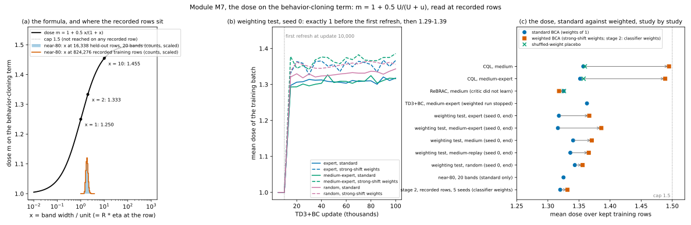

# Module M7. The dose on the behavior-cloning term

**Verdict: works with a caveat.**
**Takeaway for the advisor:** "The dose is computed exactly as specified and behaves exactly as specified on every
recorded row, standard and weighted, but it is nearly a constant 1.33: it saturates, so weighting moves it by only
0.02 to 0.15 and no study has shown that it raises return."

This page tests one component of BCA in isolation: the multiplier BCA puts on the host's pull toward the recorded
command. It says what the component is, what "working" means as a checkable statement, tests it on made-up inputs
where the truth is known, recomputes it from recorded ThrusterChain inputs, and reads what the records say about it
under IID and shifted conditions, standard and weighted. Nothing was trained and no band was fitted: every number is
either recomputed from recorded inputs by `scripts/M7_test.py` (or its pinned-environment job files) or copied from a
record named beside it.

## 1. What the module is, in plain words

**Words used.** A *recorded row* is one step of the log: state s, command a, reward r, next state s'. The *training
rows* are the rows the learner trains on; after a *removal* (rows hidden from training) the rest are the *kept training
rows*. The *held-out rows* are rows set aside for calibration (about 800-850 per seed here). The *critic* is the host's
value network; the *actor* is the controller being trained. TD3+BC trains the actor with two terms: a push toward
commands the critic values highly, and a *behavior-cloning term*, the squared distance between the actor's command and
the recorded command at each training row, which pulls the actor toward what the recorded controller did. *The band* is
BCA's error band around the critic, with half-width U(s, a) = R · u · η(s, a): R is the *threshold* (module M5), u the
*unit* (a running scale of the critic's error), η the *error-size network* (module M2). *The dose* m is this module: a
per-row multiplier on the behavior-cloning term, larger where the band is wide relative to the unit.

**Formula.** For training row i, with x_i = U_i / u (the band width in units):

    m_i = 1 + 0.5 · U_i / (U_i + u) = 1 + 0.5 · x_i / (1 + x_i)

so m = 1 when the band has no width, 1.25 when the band is one unit wide (x = 1), 1.333 at two units, 1.455 at ten
units, and approaches 1.5 from below. The band is read at the recorded row (s_i, a_i), never at the actor's own command.
The actor loss on every second update is

    loss = −λ · mean_i Q1(s_i, π(s_i)) + mean_i m_i · mean_j (π(s_i)_j − a_ij)²,   λ = α / mean_i |Q1(s_i, π(s_i))|

with α = 2.5 (`configs/td3_bc.yaml:12`), the actor updated every 2nd critic update (`policy_freq: 2`, line 15), blend
0.5 (line 20). m is detached from every gradient: it changes the weight of each row's pull, not the direction of
anything else.

**Where it lives.** `calibration/dose.py:23-62` (`level_critic_dose`: the normalized ratio at lines 53-59, the dose at
60), `calibration/dose.py:65-95` (`frozen_level_dose`: the width at 75-76, "not ready" at 90-92);
`algorithms/td3_bc_bca.py:283-288` (`bc_readout`: η at the recorded row, line 284) and 295-324 (`update`: the
multiplier handed to the host at 310, the validity gate at 312-322); `algorithms/td3_bc.py:102-105` (one multiplier per
row) and 128-139 (the actor loss; λ at 131; the detached multiplier at 136), 162-163 (every `policy_freq`-th update);
`ALGORITHMS.md:334-340` (Procedure D). Variants: the weighting test's per-row dose
`experiments/shift_iw/learners_iw.py:655-683` (refusal gives 1.5 at 681-682) and its dose-change readout 719-729; the
four-learner study's carried refusal rule `experiments/shift_hosts/iw.py:279-312` (branch `claude/shift-hosts`; the
flag at 311) and its table of rules per learner 383-412; IQL's counterpart `calibration/advantage.py:32-70` (not a
dose: the advantage weight min(e^{βA}, cap) is shrunk toward 1 by the fraction A/(A + U), and an unsupported row gets
weight 0); the main study's placement variants `experiments/shift/learners.py:1106-1121` (`place`: "own",
"flattened", "shuffled", "noise_map"). Host settings: `experiments/shift/learners.py:104-105` (blend 0.5, first refresh
at update 10,000, then every 5,000).

## 2. "Working as intended" as a checkable statement

The module works if, on every training row of every batch:

1. m_i = 1 + 0.5 · U_i/(U_i + u) to within float32 rounding (about 1.2e-7 near 1.3);
2. 1 ≤ m_i ≤ 1.5, with m_i < 1.5 on every row that can occur (see correction (a) below for the float32 cap);
3. m does not fall as U rises, except by one float32 step between neighboring widths;
4. m_i = 1 on every row before the first refresh (BCA switched on but not yet calibrated: the host runs unchanged);
5. when the threshold is +infinity (refusal, module M5), standard BCA gives m_i = 1 (the host's own multiplier) and the
   per-row weighted arms give m_i = 1.5 (the most caution); the two rules differ by design and the record says which
   one each study used;
6. with weights of 1 the weighted (per-row) dose is standard BCA's dose bit for bit;
7. with every m_i = 1 the host's loss is plain TD3+BC's;
8. m is read at the recorded (state, command) pair of each row, so it cannot depend on the test condition.

Points 1-3 and 5 (standard rule) are what the weighting test's pre-registered mark M3 checked on real training rows;
point 6 is its mark W0 and the four-learner study's stop rule S2.

## 3. Pseudocode, line by line

Copied from `MODULES.md` (module M7) with the corrections found here marked `[corrected]` or `[added]`:

```
1  [M7.1 readout point]  read eta_f at the RECORDED row (s_i, a_i), not at the actor's command
                         algorithms/td3_bc_bca.py:284
2  [M7.2 width]          U_i = R * u_f * max(eta_f(s_i, a_i), 1e-6)                calibration/dose.py:75-76
3  [M7.3 dose]           m_i = 1 + 0.5 * U_i / (U_i + u_f)   (float32; the ratio is formed from U and u each divided
                         by max(U, u), so it cannot overflow)                       calibration/dose.py:53-60
4  [M7.4 refusal]        R = +infinity: U_i = +infinity, the row is "unsupported" and standard BCA gives m_i = 1
                         (calibration/dose.py:52-53, 68-69); the weighting test's per-row arm and the four-learner
                         study's weighted setups give m_i = 1.5 (learners_iw.py:681-682; iw.py:310-311)
5  [M7.5 not ready]      before the first refresh: U_i = 0 and m_i = 1 on every row   calibration/dose.py:90-92
6  [M7.6 use]            every 2nd update (policy_freq 2):
                           loss = -lambda * mean_i Q1(s_i, pi(s_i)) + mean_i m_i * mean_j (pi(s_i)_j - a_ij)^2
                           lambda = alpha / mean_i |Q1(s_i, pi(s_i))|
                         [corrected] lambda is detached from the gradient and recomputed at every actor update
                         (td3_bc.py:131); it is not held fixed over training. m is detached (td3_bc.py:136).
                         algorithms/td3_bc.py:128-139, 162-163
7  [M7.7 per-row]        with weights: m_i uses the row's own threshold R(w_i) from the per-step table (M5.9)
                         experiments/shift_iw/learners_iw.py:655-683
8  [M7.8 validity]       [added] if any input is not finite (eta, u, R not a number or negative), inputs_valid is
                         false and the whole update is discarded (the state is kept); a bad input is never dosed
                         silently.  calibration/dose.py:44-51, 77-89; algorithms/td3_bc_bca.py:312-322
```

**Corrections to the map's statement of the module.**
(a) `MODULES.md` says m < 1.5 and "the limit is 1.5 (never reached)". In exact arithmetic that is right; in the float32
arithmetic BCA runs, 1.5 − m is about 0.5/x, and once that is below half a float32 step at 1.5 the dose rounds to
exactly 1.5. The crossover is x = U/u of about 5.6 million (found by bisection, check A1). The largest dose on any
record is 1.4997 (CQL under strong-shift weights, B4), x about 1,800, three thousand times below the crossover, so the
practical statement "m < 1.5 on every recorded row" stands; the exact statement is "1 ≤ m ≤ 1.5, with 1.5 only for
widths millions of times the unit".
(b) "λ held constant" in the map means detached from the gradient; λ is recomputed at every actor update.
(c) Line 8 above (the validity gate) was missing from the map's block; it is part of how the module behaves on a bad
input.
(d) The map says mark R2 "failed on these two qualities and BCA's training arms were not run there". Exact: R2 failed
on medium-expert and expert (predicted return change +0.92 and +0.42 points, bar 1.8); on random, medium-replay and
medium R2 passed only because the predicted change was large and negative (−3.4 to −5.1 points), and there the room
check R1 failed. The training arms (mark I1) needed M1, R1 and R2 to pass and ran on no quality
(`experiments/shift_iw/run.py:19-21`; `outputs/shift_iw/v5/<quality>/report.json` marks.I1.why).

## 4. Synthetic test: the truth is known (Part A of `scripts/M7_test.py`)

The formula of `calibration/dose.py` is called directly on made-up widths, units and thresholds, so the right answer is
known in advance. Environment: Windows, Python 3.14.2, NumPy 2.5.4, JAX 0.12.0 (CPU); the same calls in the pinned
environment give the numbers in Part B2.

| Check | What was done | Result |
|---|---|---|
| A1 range and closed form | 3,602 widths from 0 to 10^30 units, two units (1.0 and 0.157) | m(0) = 1; 1 ≤ m ≤ 1.5 everywhere; m < 1.5 for every x ≤ 10^6; largest gap to 1 + 0.5x/(1+x): 9.2e-8 (allowed 2.4e-7); float32 reaches exactly 1.5 from x = 5.59e6 on. **PASS** |
| A2 monotone | 100,000 random widths, sorted | 0 falls of the dose as the width rises (the weighting test's bar 1e-6). **PASS** |
| A3 not ready | 1,000 rows, reference not yet refreshed, threshold +infinity | every width 0, every dose 1, inputs valid. **PASS** |
| A4 refusal | threshold +infinity, reference ready | standard rule: width +infinity, row unsupported, dose 1 on every row; per-row rule (learners_iw.py:681-682): dose 1.5 on every row. **PASS** |
| A5 one threshold | per-row dose with R_i = R on every row | equals `frozen_level_dose` byte for byte (dose, width, support); 0 refused. **PASS** |
| A5b own threshold | rows at 0.5R, R, 2R, 4R | each row gets the standard dose at its own threshold, bit for bit. **PASS** |
| A6 saturation | the slope of m in ln U is 0.5x/(1+x)², at most 0.125 at x = 1 | from x = 2 (dose 1.333) a 1.45× threshold adds +0.038; from x = 2.5, +0.035; from x = 10, +0.013 (table in `data/M7_table.txt`) |
| A7 host loss | the cloning term with every m_i = 1 against plain TD3+BC's | 1.959833 against 1.959834 (equal to 1e-6); with m in [1, 1.5) it is larger (2.440608). **PASS** |

The seven project unit tests of the bit-for-bit identities (points 5 and 6 of section 2), among them
`experiments/shift_iw/test_learners_iw.py:494` (weights of 1 give the standard arm, state for state) and `:524` (the
per-row arm with weights of 1 is BCA itself), were run on synthetic data in the pinned environment:
`scripts/M7_pinned_unit_tests.sh`, output `data/M7_pinned_unit_tests.out` (7 tests, OK, 46 seconds).

## 5. Real-data test: recorded ThrusterChain inputs (Part B)

### B1, B2. The near-80 run's 20 recorded bands, at the held-out rows and at the recorded training rows

The near-80 run (version 8; `outputs/shift/beyond-the-data/near80/`, run files on branch `claude/near80-run-files`)
recorded, for each of 2 settings × 2 worlds × 5 data seeds, version 6's band after one refresh on a fixed critic:
R, u (in `v6_band.json`, `uniform`), η at the held-out rows (`v6_bank_scores.npz`) and the band's parameters
(`v6_band.msgpack`). The run itself used the band in its harm switch, not as a dose (its actors ran with
`weighted=False` arms, `near80/code/learner_phases.py:20-24`), so B1 and B2 are *the dose BCA would read from these
recorded bands*, a recomputation from recorded inputs, description only.

- **B1** (Windows environment): the dose at the 805-832 held-out rows of each band from the recorded R, u, η. Mean dose
  1.307 to 1.341 over the 20 bands (average 1.325); every dose in [1, 1.5); the record's own `U_max` equals
  R · u · max(η) of the arrays on 20 of 20 bands. PASS.
- **B2** (pinned environment, `scripts/M7_near80_training_dose.sh`, output `data/M7_near80_training_dose.json`): the
  same 20 bands read at the 40,969-41,456 recorded training rows of each setting (824,276 rows in all) through BCA's own
  readout path (`frozen_level_dose` on η from the saved band). Mean dose 1.307 to 1.341 (average 1.325); smallest
  single dose 1.041, largest 1.392; largest fall of the dose as the width rises 1.19e-7 (one float32 step) on every
  band; largest gap to the closed form 1.05e-7; refused rows 0; inputs valid on 20 of 20. These are the three
  statistics the weighting test's mark M3 defines (`experiments/shift_iw/coverage.py:365-380`), reproduced on a
  different run. PASS. The dose at full-throttle rows (throttle above 90%, 33-57 rows per band) differs from the dose
  at rows at or below 70% throttle by −0.009 to +0.012: the dose does not single out the rows the harm switch later
  targets.
- A side flag in that job, `normalisation_matches_record: false` on 20 of 20 bands, is expected: the record's
  normalization constants are the gate's (the states kept under the main test's removal), shared by the near80 and
  random_rows settings (`near80/code/settingdata.py:7, 154`), while the flag compared them with each setting's own
  training file (largest difference 5.6e-3; `scripts/M7_near80_normalization_check.sh`,
  `data/M7_near80_normalization_check.out`). The readout used the record's constants, as the learner did.

### B3. The weighting test (pre-registered marks M3, W0, R2; `outputs/shift_iw/v5/<quality>/report.json`, branch `main`)

| Quality | M3 | largest fall (5 seeds) | largest closed-form gap | rows per seed | R2: mean dose change, strong-shift weights [95% interval] | refused rows | predicted return change | R2 | R1 | I1 |
|---|---|---|---|---|---|---|---|---|---|---|
| random | pass | 1.19e-7 | 1.07e-7 | 49,919 | +0.020 [+0.017, +0.024] | 0 | −5.12 | pass | fail | not run |
| medium-replay | pass | 1.19e-7 | 1.12e-7 | 48,698 | +0.018 [+0.007, +0.029] | 0 | −3.37 | pass | fail | not run |
| medium | pass | 1.19e-7 | 1.09e-7 | 47,439 | +0.029 [+0.022, +0.036] | 0 | −4.58 | pass | fail | not run |
| medium-expert | pass | 1.19e-7 | 1.08e-7 | 45,301 | +0.053 [+0.036, +0.071] | 0 | +0.92 | fail | pass | not run |
| expert | pass | 1.19e-7 | 1.04e-7 | 42,500 | +0.039 [+0.025, +0.054] | 0 | +0.42 | fail | pass | not run |

Bars on record (`report.json` `thresholds`): M3 `max_dose_drop` 1e-6; R2 `min_abs_predicted_return` 1.8; W0
`bit_for_bit` true (W0 passed on all five qualities: the per-step table on weights of 1 is the unweighted threshold and
the per-step coverage is identical). Reading: the mechanics pass everywhere; weighting for the strong shift raises the
mean dose by 0.02 to 0.05, too little to predict a return change of 1.8 points on the two qualities where the room
check passed, so BCA's training arms never ran (correction (d) above).

**The dose over training** (exploratory diagnosis, seed 0, `outputs/shift_iw/explore/routes2/diagnose/dose_chunks.json`;
figure panel b): the mean multiplier of the training batch is exactly 1.000 at every readout before the first refresh
(update 10,000) on all five qualities and both arms, then 1.29-1.39; the strong-shift-weighted arm sits 0.02-0.06
above the unweighted one throughout (for example expert 1.318 against 1.367 at update 100,000). PASS (point 4).

**Closed form on recorded quantiles** (`diagnosis_numbers.json`, `diag_band_at_commands.json`): the recorded 5% and
95% dose quantiles equal 1 + 0.5Rη/(Rη + 1) of the recorded η quantiles to four decimals on all five qualities (a
monotone map carries quantiles to quantiles); the recorded mean dose over 4,151 recorded rows sits 0.0004-0.0025 below
the closed form of the mean width, the direction concavity requires. PASS (point 1 on a second record).

### B4. The four-learner study (exploratory, seeds 0-4; `outputs/shift_hosts_v3/results.json`, branch `claude/shift-hosts`)

The dose at the last refresh over the kept training rows, standard BCA against weighted BCA (exact strong-shift
weights), with two controls recorded in the same study: shuffled weights (a placebo) and classifier-estimated weights.

| Learner, data | R, standard | mean dose, standard (seed range) | mean dose, weighted (seed range) | change, weighted − standard | placebo | estimated weights | min / max dose | refused rows |
|---|---|---|---|---|---|---|---|---|
| CQL, medium | 1.877 | 1.357 (1.347-1.373) | 1.495 (1.493-1.497) | +0.141 | +0.002 | +0.142 | 1.009 / 1.500 | 0 |
| CQL, medium-expert | 1.978 | 1.352 (1.336-1.385) | 1.489 (1.472-1.495) | +0.137 | +0.006 | +0.137 | 1.008 / 1.499 | 0 |
| ReBRAC, medium | 1.350 | 1.325 (1.299-1.354) | 1.318 (1.278-1.348) | −0.005 | +0.001 | −0.005 | 1.177 / 1.379 | 0 |
| TD3+BC, medium-expert | 2.120 | 1.363 (1.357-1.368) | (weighted run stopped by stop rule S7) | | | | 1.277 / 1.407 | 0 |

Every recorded dose is in [1, 1.5); 0 refused rows (18 of 18 refreshes certified in every run). The strong-shift
weights raise CQL's dose on 10 of 10 seeds (+0.125 to +0.156, to within 0.01 of the cap); shuffled weights change it by
−0.008 to +0.017 (placebo); ReBRAC's critic did not learn, so its band and dose barely move. IQL and TD3+BC's weighted
setup were stopped by stop rule S7 and are not judged. (The "max dose" 1.500 printed for CQL medium is 1.4997 to four
decimals, `train_rows_last[].max_dose`, x about 1,800: the cap is approached, not reached.)

### B5. Stage 2's recorded widths (description only; `runs/shift_explore/stage2/detect`, WSL, read-only copies)

Stage 2 used the band's width in the lower edge (module M9), not as a dose. Its recorded widths let one read what
dose the same band would imply at recorded rows (set T4) and at the actor's own command on strong-current rollout
states (set T3), stall world, seeds 0-4:

| Seed | R, u (uniform band) | uniform band: dose at recorded rows (U) | uniform: dose at the actor's command, strong current (U) | classifier-weighted band: recorded rows (U) | weighted: actor's command, strong current (U) |
|---|---|---|---|---|---|
| 0 | 1.519, 0.174 | 1.320 (0.310) | 1.310 (0.303) | 1.335 (0.361) | 1.414 (1.362) |
| 1 | 1.480, 0.168 | 1.314 (0.287) | 1.314 (0.316) | 1.384 (0.566) | 1.397 (0.891) |
| 2 | 1.514, 0.162 | 1.320 (0.289) | 1.334 (0.331) | 1.331 (0.320) | 1.384 (0.666) |
| 3 | 1.501, 0.152 | 1.322 (0.276) | 1.331 (0.311) | 1.308 (0.248) | 1.372 (0.668) |
| 4 | 1.470, 0.152 | 1.324 (0.281) | 1.348 (0.357) | 1.300 (0.229) | 1.360 (0.469) |

The uniform band gives the same dose (1.31-1.35) at recorded rows and at the actor's commands under strong current;
the weighted band's width at the actor's commands is 1.3 to 4.5 times the uniform band's, but the dose it would imply
rises only to 1.36-1.41: saturation again.

## 6. Figure and the small table



`figures/M7.svg` (written by `scripts/M7_test.py`): (a) the formula with the recorded widths of the near-80 run drawn as
counts along the bottom (16,338 held-out rows, 824,276 training rows): every near-80 row sits between x = 0.7 and
x = 3.6, where the dose is 1.21-1.39 and the curve is already flat; (b) the dose over training in the weighting test:
exactly 1 before the first refresh, then 1.29-1.39, the weighted arm a little above the standard; (c) the mean dose,
standard (circle) against weighted (square), study by study, with the shuffled-weight placebo (cross).

**The dose by condition, every record (means over kept training rows):**

| Condition | Standard BCA (weights of 1) | Weighted BCA | Source |
|---|---|---|---|
| TD3+BC, five D4RL-style qualities (weighting test), IID training rows | 1.316-1.343 at the end (1.29-1.39 over training) | strong-shift weights: +0.018 to +0.053 | B3, `report.json` marks.R2; `dose_chunks.json` |
| TD3+BC, Unifloral host, medium-expert | 1.363 | run stopped (S7) | B4 |
| CQL, medium and medium-expert | 1.352-1.357 | 1.489-1.495 (+0.137 to +0.141); placebo +0.002 to +0.006 | B4 |
| ReBRAC, medium | 1.325 | 1.318 (−0.005) | B4 |
| ThrusterChain near-80, 20 bands, recorded training rows | 1.307-1.341 | not recorded | B2 |
| ThrusterChain stage 2, recorded rows | 1.314-1.324 | classifier weights: 1.300-1.384 | B5 |
| Any test condition (IID, strong current, waves, kicks) | the same numbers: the dose is read at training rows | | point 8 |

## 7. Consistent and exceptional cases (the advisor's questions)

- **Is the penalty low under IID and higher under shift?** For the dose the question has a structural answer: the dose
  is read at the recorded training rows from a threshold fixed at the last refresh, so a shift in the test states cannot
  reach it (point 8; `td3_bc_bca.py:284`). Under IID it is not "low" either: 1.31-1.36 on every host, quality and
  benchmark on record. It rises under shift only when the shift is declared through weights (B3, B4), and then by
  0.02-0.05 (TD3+BC) or 0.14 (CQL). Consistent on every seed of every study.
- **Does weighting ever give a higher penalty under IID than standard BCA?** With weights of 1, never: the two are
  identical bit for bit (W0: 150 of 150 checks over 25 seed-qualities; S2: passed for all four learners,
  `results.json` integrity.S2; the unit tests of section 4). With
  weights fitted to an IID test the move is classifier noise (B4's "estimated weights" column equals the exact-weight
  change because that study estimated the strong shift's weights, not IID ones; the weighting test's IID-estimated
  thresholds moved R by −9% to +5% on single seeds, module M4). With weights for a strong shift applied to IID training
  rows the dose rises on every seed, by construction: that is the band answering a different question, not a fault.
- **Refusal in the dose channel never happened on record:** refused rows are 0 in every M3 and R2 readout, every
  four-learner refresh (18 of 18 certified per run) and every near-80 band. Had it happened, the two rules in line 4
  would give different doses (1 or 1.5), so a reader of any future record must check which rule the study carried
  (`iw.py:383-412`).
- **Why the dose cannot move much (the caveat).** On TD3+BC's critics x = U/u is between 0.7 and 3.6 on the near-80
  training rows and 1.1-2.4 (5th to 95th percentile, seed 0) in the weighting test. There the slope of the dose in ln U
  is at most 0.125 and falling (A6), so even the 1.2-1.8× threshold change that strong-shift weights cause moves the
  dose by a few hundredths; CQL's wider bands (x in the hundreds to thousands under weights) sit even further out on
  the flat part, which is why its dose ends within 0.01 of the cap. The dose also varies little from row to row within a batch (standard
  deviation 0.007-0.013 over the near-80 training rows, B2): it acts as a nearly constant extra pull of 1.33 rather
  than as row-by-row caution. This is the mechanism behind R2's failure and behind the toy's finding
  (`bca_channel_toy.ipynb`, branch `main`, cell out 15: A2, this dose in a two-step world, regret 0.3755 against 0.1215
  for a rule that refuses thin data and 0.4939 for the plain host; shelved by its pre-written test 1).

## 8. What was pre-registered, exploratory, or description only

- Pre-registered and on record: the weighting test's marks M3 (mechanics on real training rows), W0 (weights of 1 give
  the unweighted threshold and coverage) and R2 (dose change under strong-shift weights), specification version 5,
  five seeds per quality; the four-learner study's stop rule S2 (pre-specification version 3; seeds 0-4 are its
  exploratory block).
- Exploratory: the four-learner dose readouts (B4), the dose-over-training diagnosis (B3, seed 0), the toy.
- Description only (new here, nothing pre-registered): the synthetic checks of Part A, the recomputed dose at the
  near-80 bands' held-out and training rows (B1, B2), the dose implied by stage 2's widths (B5), the closed-form
  checks on recorded quantiles.
- Not tested anywhere: whether the dose raises return. The main study ran no BCA arm; the weighting test's BCA arms
  did not run; the four-learner TD3+BC standard-alone comparison (+6.54 points on medium-expert, Holm-adjusted p
  0.107) is shelved as not significant.

## 9. How to reproduce

From the repository root on Windows (any Python 3 with NumPy, JAX on CPU and Matplotlib; git on PATH):

    set PYTHONPATH=M:\
    set PYTHONDONTWRITEBYTECODE=1
    set JAX_PLATFORMS=cpu
    python docs\bca_mechanics\scripts\M7_test.py --root M:\ [--stage2 <dir>] [--png <file>]

It prints Parts A to B5 (`data/M7_table.txt` is its output), writes `figures/M7.svg`, and takes about 20 seconds.
Part B5 needs read-only copies of stage 2's run files from the owner's WSL clone (the file list is in the script's
header); without `--stage2` it is skipped and everything else runs. Numbers that had to match a record exactly were
produced in the pinned environment (Python 3.10.20, NumPy 2.2.6, JAX 0.6.2) through the owner's bridge:

- `scripts/M7_near80_training_dose.sh` → `data/M7_near80_training_dose.json` (B2; about 2 minutes);
- `scripts/M7_pinned_unit_tests.sh` → `data/M7_pinned_unit_tests.out` (the seven bit-for-bit unit tests);
- `scripts/M7_near80_normalization_check.sh` → `data/M7_near80_normalization_check.out` (the side flag of B2).

Files read, all read-only: `calibration/dose.py`, `calibration/reference.py`, `algorithms/td3_bc.py`;
`origin/claude/near80-run-files:runs/shift_explore/near80/learners/*/*/seed*/{v6_band.json, v6_bank_scores.npz,
v6_band.msgpack}` and `.../data/*/*/seed*/train.hdf5` (WSL); `origin/main:outputs/shift_iw/v5/*/report.json`;
`outputs/shift_iw/explore/routes2/diagnose/{dose_chunks, diagnosis_numbers, diag_band_at_commands}.json`;
`origin/claude/shift-hosts:outputs/shift_hosts_v3/results.json`; stage 2's `pairs.npz`, `band.json` and
`scores/bca_width_*_fixed.npz` per seed.
