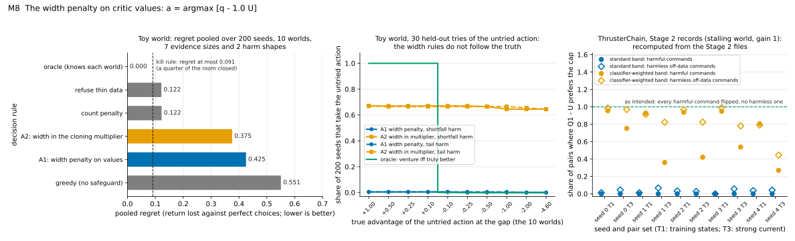

# M8. The width penalty on critic values (toy worlds only)

**Verdict: does not work** (toy worlds, toy seeds; the kill rule was written and fingerprinted before the run; the
rule was never run on ThrusterChain or any other host; its precondition also fails on ThrusterChain's recorded bands).

**The one sentence for the advisor.** *Subtracting the band width from the critic's value was tested only in a toy
and did worse than refusing thin data (regret 0.43 against 0.12), because the width is measured where the data are
and cannot see how an untried action turns out.*

**In full:** *Subtracting BCA's band width from the critic's value at every action was tested
only in a toy world, where it lost more return than simply refusing thinly covered actions (regret 0.43 against 0.12),
because the width measures how noisy an action's recorded outcomes are, not whether the critic is wrong about an
action that was never recorded; on ThrusterChain's recorded bands the same penalty would have changed 0.0-0.1% of the
critic's harmful full-throttle choices.*

Written 20 October 2026. Code: `bca_channel_toy.ipynb` on branch `main` (cells 2, 4, 6, 8, 12, 13, 15, 17, 19, 23).
Module map: `docs/bca_mechanics/MODULES.md`, section M8. Reproduction: `docs/bca_mechanics/scripts/M8_test.py`
(its printed output is quoted below; section 9 gives the command). Figure: `docs/bca_mechanics/figures/M8.svg`. Nothing was trained for this
document.

---

## 1. What the module does, in plain words

BCA puts an error band around a critic. The **critic** is the learned estimate q of how much return an action earns
from a state. The **band** is q ± U, where U is the **half-width** (the "width" below). This module is one way of
*using* the band: at every decision, subtract the width from the critic's value and take the action with the best
remainder,

    a* = argmax_a [ q(state, a) − 1.0 · U(state, a) ].

The idea is that a wide band marks an action the critic may be wrong about, so the penalty steers away from it.

**Where it was tested.** Only in a toy world, `bca_channel_toy.ipynb` (branch `main`), as the rule named "A1 width
penalty". The same notebook tested "A2", the dose of module M7 (the band width inside the behavior-cloning multiplier)
in a discrete copy of the TD3+BC host. An earlier notebook, `bca_discrete_toy.ipynb` (cell 8, stored table, demo seed 7), ran the same penalty with no
held-out tries of the untried action: every rule refused that action through an infinite width, every calibrated width
(conformal or BCA, weighted or not) chose the same actions, and all of them turned off the good noisy action at
(t = 1, c = 0), costing 0.175 of return in both of its worlds against 0 for simply refusing unsupported actions. So the
penalty improved no decision there either. The rule has never been
run on ThrusterChain (the project's simulated boat), on the D4RL hosts, or in any training loop.

**The toy world** (notebook cell 3, constants in cell 2). Two steps (t = 0, 1), two contexts (c = 0, 1), two actions
(*safe* and *venture*). The recorded log holds 1,800 episodes; two thirds train the critic, one third are the
**held-out rows** (the notebook's "calibration" rows). The log never ventures at (t = 1, c = 1): that cell is the
**gap**, the one decision the data do not cover. Separately, the log holds 5 to 100 **held-out tries of the gap
action** (the notebook's "survivors"); the critic never sees them, only the safeguards do. The critic is a table of
cell means where a cell has at least 20 training rows; at the gap it guesses by analogy and values venture at about
1.5 against 1.0 for safe (the **claimed advantage**, mean 0.504 over seeds). Ten **worlds** differ only in what
venturing at the gap truly earns: a true advantage of +1.0, +0.5, +0.25, +0.1, −0.1, −0.25, −0.5, −1.0, −2.0 or −4.6,
in two **harm shapes** (every outcome a bit worse, "shortfall"; a rare catastrophe of −5, "tail"). **Regret** is the
return lost against perfect choices, computed exactly at the deployment mix of contexts; 0 is perfect. **Pooled
regret** is the mean over 200 seeds, 7 evidence sizes, 2 shapes and 10 worlds. The **room** is the pooled regret of
the best rule that never reads the held-out tries (refusing thinly covered actions: 0.1215). A rule's **gain** is how
much of the room it closes. The **oracle** knows each world and has regret 0.

---

## 2. What "works as intended" means (checkable statements)

- **C1, the pre-registered bar (kill rule test 1, cell 10, fingerprint `bb9e0325…dbc3`).** The width-penalty rule
  closes at least a quarter of the room: pooled regret at most 0.1215 − 0.25 × 0.1215 = 0.0911. Otherwise it is shelved.
- **C2, mechanics.** The penalty is exactly the band's half-width (gain 1.0); the rule takes the venture action if and
  only if q_venture − q_safe > U_venture − U_safe; and the width is calibrated where it is measured (at least 90% of
  fresh recorded rows fall inside q ± U).
- **C3, purpose, on real data.** Where the critic over-prefers an off-data command that is truly worse than a
  capped version of it, q − U should prefer the capped command; where the off-data command is harmless, it should not.
  (This is the only form in which the rule can be checked on ThrusterChain's records without training.)

---

## 3. Pseudocode, labeled (from MODULES.md, with corrections and additions marked)

Source: `bca_channel_toy.ipynb` cell 12 (the rule cell), lines 51-52 and 88-93; the scale in cell 6 lines 25-36; the
threshold in cell 8 lines 42-47. Copied from MODULES.md M8 and extended; changes are marked.

```
0  [M8.0 scores]      [ADDED] score of a held-out row = |y − q(t, c, a)| / scale(t, c, a), where y is the row's reward
                      and, at step 0, the reward plus the critic's value of the safe action at step 1 (cell 6 lines 1-4);
                      scale(t, c, a) = the cell's residual SD on training rows, shrunk toward the step's pooled SD with
                      5 pseudo-rows, floor 0.05; a cell with no training rows gets the pooled SD (cell 6 lines 25-36)
1  [M8.1 threshold]   r_t = the exact BCA threshold on the held-out scores of step t: the larger of the plain 90%
                      quantile and the score with x scores above it, x the largest with P(Binomial(n, 0.1) ≤ x) ≤ 0.05
                      (cell 8, bca_exact: the infinitely-many-draws form, not the 1,000-draw sampler)   [CORRECTED: made exact]
                      step 0: all held-out rows of step 0 (cell 12 line 51);
                      step 1: ALL held-out rows of step 1 PLUS the held-out tries of the gap action, scored as
                      |q(gap) − outcome| / scale(gap) (cell 12 lines 52, 88): one shared threshold for every cell
2  [M8.2 width]       U(t, c, a) = r_t · scale(t, c, a)          (no error-size network: a per-cell SD; cell 12 line 90)
3  [M8.3 penalty]     at EVERY decision cell (t, c), not only at the gap:   [ADDED: scope]
                      choose a = argmax_a [ q(t, c, a) − 1.0 · U(t, c, a) ]   (cell 12 line 92; GAIN = 1.0, cell 2 line 18)
4  [M8.4 variant A2]  [ADDED] the same U inside M7's dose, m = 1 + 0.5 · U/(U + u), u the step's residual SD,
                      in a discrete behavior-cloning actor (cell 12 lines 20-23 and 93)
5  [M8.5 judged by]   pooled regret against the kill rule (cell 15 lines 4-7; cell 17 lines 4-6)
```

Corrections to MODULES.md's M8 text: (i) "the toy's per-cell scale (pooled residual SD, shrunk with 5 pseudo-rows)"
should read "each cell's own residual SD shrunk toward the step's pooled SD with 5 pseudo-rows, floor 0.05; at the gap,
which has no training rows, the scale is the pooled SD" (0.677 in seed 0, against 0.239 for the safe action in the
same context); this difference, not the gap's outcomes, is what decides the gap. (ii) The rule changes decisions at
all four cells, and that is where most of its loss comes from (section 4, S3). (iii) The notebook's threshold is the
exact binomial form; the production sampler with 1,000 draws is not used in A1 or A2.

---

## 4. Synthetic test: the toy world, where the truth is known

`M8_test.py` re-implements the notebook's world, critic, scale, threshold and the A1 and A2 rules with the notebook's
own code (copied line for line; the gate rules are left out, they do not touch A1 or A2) and reruns the 200 seeds in
about 5 seconds. Every number below equals the notebook's stored output (cells 13, 15, 17, 19, 23).

**Table A1. Pooled regret** (200 seeds × 7 evidence sizes × 2 shapes × 10 worlds; `M8_test.py` Part A; notebook cell 15).

| Rule | Pooled regret | Gain / room | Ventures at the gap in unsafe worlds |
|---|---|---|---|
| oracle (knows each world) | 0.0000 | 1.00 | 0.250 |
| greedy (no safeguard) | 0.5505 | −3.53 | 1.000 |
| refuse thin data (the best world-blind rule; room = 0.1215) | 0.1215 | 0.00 | 0.000 |
| count penalty (q − 1/√(rows + 1)) | 0.1222 | −0.01 | 0.000 |
| host, behavior-cloning actor, no BCA | 0.4939 | −3.06 | 0.865 |
| **A1, width penalty on values (this module)** | **0.4253** | **−2.50** | 0.003 |
| A2, width in the cloning multiplier (M7's dose) | 0.3755 | −2.09 | 0.649 |

Kill rule test 1 (cell 17): A1 gain / room = −2.50 → SHELVED; A2 −2.09 → SHELVED. **C1 fails.** An "unsafe world" is
one where more than 10% of the gap action's outcomes fall below the safe action's mean.

**Table A2. By number of held-out tries of the gap action** (notebook cell 19).

| Held-out tries | 5 | 10 | 20 | 30 | 45 | 60 | 100 |
|---|---|---|---|---|---|---|---|
| refuse thin data, pooled regret | 0.1215 | 0.1215 | 0.1215 | 0.1215 | 0.1215 | 0.1215 | 0.1215 |
| A1, pooled regret | 0.4274 | 0.4253 | 0.4250 | 0.4250 | 0.4247 | 0.4247 | 0.4247 |
| A2, pooled regret | 0.4075 | 0.4075 | 0.4018 | 0.3985 | 0.3872 | 0.3368 | 0.2891 |
| A1: share of (seed, shape) whose gap decision changes across the 10 worlds | 0.00 | 0.01 | 0.01 | 0.01 | 0.01 | 0.01 | 0.01 |
| A2: the same | 0.00 | 0.00 | 0.02 | 0.03 | 0.05 | 0.20 | 0.35 |

More evidence about the gap action does not help A1 at all: its decision at the gap is the same in all ten worlds for
99% of (seed, shape) pairs.

**S1. The penalty is the width, and the decision is the closed form (C2).** In all 112,000 decision cells
(200 seeds × 7 × 2 × 10 × 4 cells) the penalty equals 1.0 × U and the rule ventures exactly when
q_venture − q_safe > U_venture − U_safe. Seed 0, 30 held-out tries, the world where venturing at the gap is truly worth
+0.50 (`M8_test.py` Table S1):

| Cell (step, context) | Training rows safe/venture | q safe | q venture | U safe | U venture | q − U safe | q − U venture | A1 picks | Truth |
|---|---|---|---|---|---|---|---|---|---|
| (0, 0) | 489 / 505 | 1.089 | 1.293 | 0.317 | 0.322 | 0.772 | 0.971 | venture | venture |
| (0, 1) | 88 / 93 | 1.086 | 1.481 | 0.346 | 1.249 | 0.739 | 0.232 | safe | venture |
| (1, 0) | 775 / 219 | 1.004 | 1.447 | 0.312 | 2.290 | 0.692 | −0.843 | safe | venture |
| (1, 1), the gap | 181 / 0 | 1.004 | 1.447 | 0.366 | 1.035 | 0.638 | 0.412 | safe | venture |

Reading it: at (1, 0) venture pays 0 or 3 (mean 1.5, truly better than safe's 1.0) and is covered by 219 training
rows; its width is 2.29 because its outcomes are noisy, so the rule refuses a good, well-recorded action. At the gap
the width is 1.035 = r_1 × 0.677, the pooled SD, against 0.366 for safe; the difference 0.67 exceeds the claimed
advantage 0.44, so the rule refuses before any outcome of the gap action is read.

**S2. The width at the gap does not follow the truth** (`M8_test.py` Table S2; 30 held-out tries, means over 200
seeds). In the four worlds where venturing at the gap is right (+1.0 to +0.1), U at the gap is 1.100 and U at safe is
0.352, difference 0.748 against a claimed advantage of 0.504: A1 ventures in 1% of seeds. In the harshest worlds the
held-out tries' large scores raise the one shared threshold r_1 (mean of its largest value 8.9 against 1.47 for its
smallest), so U at the gap rises to 1.31-1.38, but U at safe rises in step (0.42-0.44); A1 ventures in 0% of seeds.
The oracle ventures in 100% of the first four worlds and 0% of the other six. A2 ventures in 65-67% of seeds in every
world: blanket caution, not a response to the world.

**S3. Where A1's loss comes from** (exact decomposition, `M8_test.py` S3). A1's pooled regret 0.4253 = 0.3050 lost
at the cells the data cover well (it refuses venture at (1, 0), worth 0.5 × 0.35 = 0.175 of return, and at (0, 1),
outcomes −0.5 or 1.1, worth 0.2 × 0.65 = 0.130) + 0.1203 lost at the gap. The gap part is the same as the
refuse-thin-data rule's 0.1215. So the width penalty is the refuse rule plus a tax on good actions with noisy outcomes.

**S4. The width is calibrated where it is measured** (notebook check 6; `M8_test.py` S4). With seed 0's thresholds,
A1's widths covered 0.902 (step 0) and 0.935 (step 1) of fresh recorded rows, against a 0.90 target. The band is a
correct band; it is the wrong instrument for the decision.

**Consistent and exceptional cases in the toy.** Consistent: A1 never ventures at the gap (99.7% of unsafe cases,
and 99% of benign cases too); A1 refuses the two noisy good actions in every seed (the 0.305 is present at every
evidence size), and the earlier discrete toy's calibrated widths refused the same noisy action at (1, 0) on its demo
seed (cost 0.175); A2 ventures in about two thirds of seeds whatever the world. Exceptional: in 1% of (seed, shape)
pairs A1's gap decision does change along the ladder; these are seeds whose claimed advantage (up to 0.79) exceeds
U_venture − U_safe in benign worlds, and the catastrophic worlds then raise r_1 enough to flip it. A2's decision
varies more with 60-100 held-out tries (20-35%), through the same rise of r_1 inside the dose; its regret falls from
0.41 to 0.29 but stays far above 0.12.

---

## 5. Real-data test: ThrusterChain, Stage 2 records (seeds 0-4, stalling world)

The rule was never run on ThrusterChain, so there is no recorded output of it to recompute. What the records do allow
is C3: evaluating a = argmax [Q1 − 1.0 · U] at recorded (state, command) pairs where the truth is known by exact
simulation. Stage 2 (`outputs/shift/beyond-the-data/stage2/`, pre-registration 9b38c7c4) recorded, for each of seeds
0-4 and the fixed critic of the main gapped log: **pair sets** of states with the actor's own command and the same
command capped at 80% throttle (T1: 1,500 training states in the full-throttle region; T3: 3,000 strong-current
rollout states), the critic's values Q1 at both commands (`labels.npz`: `q1_command`, `q1_cap`; `critic_pref` =
Q1(command) − Q1(cap), checked equal), a **harmful** label from exact simulation (the critic prefers the command over
its cap by at least 0.1 more than the truth, and the cap is truly better by at least 0.05), an **unsupported** label
(any thruster past 80%), and BCA's band width U at every pair (`scores/bca_width_uniform_fixed.npz`; the standard band,
threshold R 1.470-1.519 on 827-851 held-out rows; and `bca_width_weighted_fixed.npz`, Stage 2's classifier-weighted
band). Files: `runs/shift_explore/detect/seed<K>/stall/{pairs,labels}.npz` and
`runs/shift_explore/stage2/detect/{uniform,weighted}/stall/fixed/seed<K>/scores/` in the owner's WSL clone, read only.
"Flipped" means Q1 − U prefers the cap. "Gain needed" is the median, over harmful pairs, of the k at which Q1 − k·U
would prefer the cap. Units are critic values. (`M8_test.py` Part B.)

| Band | Seed | Set | Harmful pairs | Harmless off-data pairs | Q1(cmd) − Q1(cap), harmful | U(cmd) − U(cap), harmful | Flipped: harmful | Flipped: harmless off-data | Gain needed |
|---|---|---|---|---|---|---|---|---|---|
| standard | 0 | T1 | 540 | 73 | 0.317 | 0.0037 | 0.000 | 0.014 | 38.9 |
| standard | 0 | T3 | 2063 | 66 | 0.735 | 0.0081 | 0.001 | 0.045 | 75.7 |
| standard | 1 | T1 | 599 | 81 | 0.281 | 0.0003 | 0.000 | 0.012 | 29.2 |
| standard | 1 | T3 | 2162 | 119 | 0.725 | 0.0122 | 0.000 | 0.067 | 36.8 |
| standard | 2 | T1 | 555 | 61 | 0.249 | 0.0013 | 0.000 | 0.033 | 191.6 |
| standard | 2 | T3 | 2110 | 74 | 0.722 | 0.0045 | 0.000 | 0.027 | 122.8 |
| standard | 3 | T1 | 572 | 103 | 0.241 | 0.0008 | 0.000 | 0.000 | 59.0 |
| standard | 3 | T3 | 1952 | 123 | 0.694 | 0.0077 | 0.001 | 0.057 | 62.0 |
| standard | 4 | T1 | 520 | 81 | 0.268 | 0.0026 | 0.000 | 0.037 | 80.9 |
| standard | 4 | T3 | 1969 | 119 | 0.665 | 0.0025 | 0.001 | 0.042 | 243.5 |
| classifier-weighted | 0 | T1 | 540 | 73 | 0.317 | 1.6448 | 0.956 | 0.986 | 0.1 |
| classifier-weighted | 0 | T3 | 2063 | 66 | 0.735 | 1.3342 | 0.752 | 0.970 | 0.4 |
| classifier-weighted | 1 | T1 | 599 | 81 | 0.281 | 1.2586 | 0.928 | 0.914 | 0.2 |
| classifier-weighted | 1 | T3 | 2162 | 119 | 0.725 | 0.3903 | 0.360 | 0.824 | 2.3 |
| classifier-weighted | 2 | T1 | 555 | 61 | 0.249 | 0.9912 | 0.937 | 0.967 | 0.2 |
| classifier-weighted | 2 | T3 | 2110 | 74 | 0.722 | 0.4190 | 0.420 | 0.824 | 1.4 |
| classifier-weighted | 3 | T1 | 572 | 103 | 0.241 | 0.9293 | 0.949 | 0.990 | 0.2 |
| classifier-weighted | 3 | T3 | 1952 | 123 | 0.694 | 0.5635 | 0.538 | 0.780 | 0.8 |
| classifier-weighted | 4 | T1 | 520 | 81 | 0.268 | 0.5063 | 0.806 | 0.790 | 0.4 |
| classifier-weighted | 4 | T3 | 1969 | 119 | 0.665 | 0.2637 | 0.271 | 0.445 | 2.3 |

What it says:

- **Standard band (the module as defined): C3 fails in 5 of 5 seeds, both pair sets.** The width differs by
  0.0003-0.012 between a harmful full-throttle command and its cap, while the critic's false preference to cancel is
  0.24-0.32 (training states) and 0.67-0.74 (strong current). At gain 1 the penalty flips 0.0-0.1% of harmful choices;
  the gain that would flip half of them is 29 to 244. It flips 0-7% of harmless off-data choices, so it is not even
  cautious; it is flat. This is the toy's finding on real data: the band is measured at recorded commands, and at an
  off-data command it reports the recorded neighborhood's noise, not the critic's error there. (The same flatness is
  recorded as Stage 2's detection marks: size 0.0004, direction 50% / 73%, fail,
  `outputs/shift/beyond-the-data/results-2026-10-13/README.md`.)
- **Classifier-weighted band (built for Stage 2's fallback, not used for a claim).** It flips 81-96% of harmful
  commands at training states and 27-75% in strong current, but it flips harmless off-data commands just as often
  (79-99% and 45-97%). Its width rises wherever the command leaves the recorded range, because the weights come from
  a classifier of "recorded or not"; it is the toy's A2 pattern, blanket caution on everything off-data, with the
  added cost that it also widens at recorded rows (0.23-0.57 against 0.28-0.31 for the standard band, higher on 3 of
  5 seeds; `modules/M7.md` B5 and `PENALTY_EVIDENCE.md` section 3.4).
- **Standard versus shifted conditions.** The standard band's width is the same on training states (T1) and
  strong-current states (T3), 0.28-0.33 everywhere; the shift does not reach it. The weighted band is wider under
  the shift only through the classifier. Neither version makes the penalty track harm.

Caveat: this evaluates the rule at recorded command-versus-cap pairs with a fixed critic, not inside a training loop.
The trained-actor form of the same idea is module M9 (the lower edge), whose verdict is also "does not work"; the
dose form is M7 and the toy's A2.

---

## 6. Figure



`docs/bca_mechanics/figures/M8.svg` (written by `M8_test.py`; three panels, colorblind-safe blue/orange/green/gray,
marker shapes as a second encoding).

- Left: pooled regret by rule in the toy, with the kill-rule bar at 0.091. A1 (0.425) and A2 (0.375) sit far to the
  right of "refuse thin data" (0.122).
- Middle: the share of 200 seeds that take the untried action at the gap, by the action's true advantage (30
  held-out tries). The oracle steps from 1 to 0 at zero advantage; A1 stays at 0.01 and A2 at 0.65-0.67 in every
  world, both harm shapes.
- Right: ThrusterChain, Stage 2 records: the share of command-versus-cap pairs where Q1 − U prefers the 80% cap, per
  seed and pair set. The standard band (blue) is at 0 for harmful and harmless commands alike; the classifier-weighted
  band (orange) is high for both.

---

## 7. Evidence labels

- *Pre-registered (toy):* kill rule test 1, written and fingerprinted before the first run (cell 10,
  `bb9e03252e9c6be5fc30e72d1172a134498198559d30f51d9552fd86a6afdbc3`); the notebook states that one code fix came
  before any result existed and that the printed numbers are unchanged. Toy seeds only; the notebook calls itself
  exploratory with respect to ThrusterChain.
- *Exploratory (new here):* the real-data pair test of section 5 and the synthetic checks S1-S3; S4 is the notebook's
  own check 6.
- *Description only:* the pseudocode of section 3.

---

## 8. Summary for the meeting

1. The width penalty on critic values is a toy-only idea and it failed its own pre-written bar by a wide margin:
   regret 0.43 against the 0.09 it needed, and against 0.12 for simply refusing thin data.
2. The band itself is fine (90.2% and 93.5% coverage where it is measured). The failure is in what the width means:
   it is large where recorded outcomes are noisy, so the penalty taxes good noisy actions (0.305 of the 0.425), and
   at an action with no data it is set by a pooled scale, so it cannot see how that action turns out (its decision at
   the gap is the same in all ten worlds for 99% of seeds).
3. On ThrusterChain the precondition fails the same way: the standard band is flat to within 0.01 between a harmful
   full-throttle command and its 80% cap, so the penalty would change 0.0-0.1% of the critic's harmful choices; a
   gain of 29 to 244 would be needed. The classifier-weighted band flips them, but flips harmless off-data commands
   just as often.
4. The consistent pattern across toy and real data is the same: the width responds to "off the data" or "noisy
   data", not to "the critic is wrong here". The exceptional cases are the 1% of toy seeds where catastrophic
   held-out outcomes raise the shared threshold enough to flip the decision, which is the gate mechanism (modules
   M10-M11), not the width penalty.

---

## 9. Reproduction

- The command that produced every number and the figure in this document, run from the worktree root in Git Bash on
  the owner's desktop, with `PYTHONDONTWRITEBYTECODE=1` set:
  `python docs/bca_mechanics/scripts/M8_test.py --runs //wsl.localhost/Ubuntu-24.04/home/user/bca`
  (Part B reads the Stage 2 files in the owner's WSL clone, read only). 8 seconds in all, 3 to 5 of them for the 200
  toy seeds. Its printed output is quoted in sections 4 and 5.
- `python docs/bca_mechanics/scripts/M8_test.py` with no argument reruns the toy (Parts A and S) anywhere and draws
  the figure from the recorded Part B values; `--copy <dir>` recomputes Part B from a copy of the files (layout in
  the script's header). NumPy and Matplotlib only; no repository import.
- Environment used here: Python 3.14, NumPy 2.5.4, Matplotlib 3.11.2 on Windows. The pinned environment was not
  needed: the toy is NumPy-only and its random streams (`default_rng` with `SeedSequence`) gave the notebook's
  numbers digit for digit (the notebook ran under Python 3.10 and NumPy 2.2.6), and Part B reads recorded arrays and
  compares them without recomputing any band. A run from scratch copies of the same files printed the same output.
- The notebook itself: open `bca_channel_toy.ipynb` from branch `main` and choose Run All (under a minute; it also
  runs the gate rules that this module does not need).
- Records read: the notebook's stored outputs (cells 8, 13, 15, 17, 19, 23, 25); Stage 2 run files named in
  section 5; `outputs/shift/beyond-the-data/results-2026-10-13/README.md` for the detection marks.
