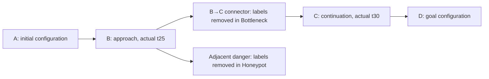

# Two missing-support scenarios: build and setup contract

This is a new task over unchanged ThrusterChain stall3 physical transitions. Old task results, datasets, checkpoints, reservations and approvals are preserved and are not reused as evidence for this task. Current authorization covers preparation and bounded task/data setup. **Policy training and scientific evaluation remain blocked until the resulting geometry and this protocol are reviewed.**

The question is whether original BCA helps avoid harmful unsupported choices without unnecessarily suppressing useful unsupported choices. It is not a promise that either learned critic will have a particular error sign. BC is unchanged: pinned UniFloral TD3+BC, td3_alpha = 2.5, BC coefficient 1, native raw-Q normalization and twin-min smoothed targets. BCA changes only the actor score to Q1 − 3U with its original live action gradient and calibration machinery. A lower-only score cannot raise an underestimated fixed Q; the connector case measures possible pessimism harm and subsequent policy learning, not an authorized new signed correction.

## One fixed task, two exclusions

Physical state contains five positions, five velocities, current and two wave coordinates; observations add remaining time. Actions remain four float32 commands in [−1, 1]. The new fixed reward is −1 − .01||a||², +100 on goal entry and −100 on danger entry. Goal/danger/horizon 100 are true terminal events with no bootstrap. Danger wins if an edge meets both goal and danger. A closed straight chord in ten physical coordinates defines danger crossing; this is an explicit discrete task convention, not an assertion about unmodeled continuous motion. Physical next states are never clamped to fabricate failure. Snapshots preserve state, actual time and terminal status, including a crossing that ends outside the danger sphere.



This diagram is a schematic of full-state configurations, not a measured spatial map or proof the connector is the only feasible route.

`protocol.json` freezes all numerical recipes and seeds before simulator outcomes. A fixed finite-horizon tracking LQR uses the existing plant matrices, Q = I on physical coordinates, R = .3I and terminal Q = 10I. Its reference positions move from .8 toward zero over 75 steps; velocity targets are zero, commands clipped at the existing knee. The nominal initial state is positions .8, velocities 0, current .02 and wave (.01, 0). No learned policy or BCA outcome chooses the geometry.

One nominal 100-step physical route determines full B = x25, C = x30, D = x75. The **physical** goal sphere is centered at D's ten plant coordinates with radius .10; this does not assume the underactuated plant can attain zero. The danger center is the endpoint of one fixed five-step opposite-controller excursion from B. Its radius is min(.10, one quarter of the minimum physical distance to every nominal route edge). The connector is a capsule from 20% to 80% along physical B→C, radius 10% of ||C−B||. Regions cannot depend only on clock or wave phase. Reject degenerate radii below .01, goal/danger overlap, B/C inside the capsule, or nominal goal entry before C. There is no geometry search, fallback or outcome-dependent retuning.

- **Honeypot:** omit every original tuple whose source, next state or physical edge touches danger. The mask applies to fitting, auxiliary fitting, calibration and normalization. Retain supported approach alternatives; no danger rewards or entering labels enter a learner.
- **Bottleneck:** omit every tuple touching the connector by the same source/next/edge rule. Retained A→B and C→D fragments keep their real next observations, times and terminal flags. Cuts are not terminal events. Original row/parent identities and separate fragment IDs remain; next_actions are not fabricated or consumed.

## Bounded setup and frozen validity checks

Before any physical execution, BUILD_ALLOCATION.json reserves 60 seconds for cheap preparation tests/hash checks and 840 seconds for the manual setup. Later study execution has at most 13,500 seconds left: total 14,400 seconds. This is an execution-time allowance, not calendar waiting time; allowances are not measured overhead.

| Setup part | Maximum actual plant transitions |
|---|---:|
| Fixed geometry, witnesses and state/time parity | 4,800 |
| One 1,280-parent collection | 128,000 |
| One exact replay of recorded tuples | 128,000 |
| **Setup total** | **260,800** |

The implemented geometry plan uses 105 construction calls, up to 4,500 witness calls and 2 snapshot parity calls (≤4,607), within the 4,800 allocation. There are at most 48 geometry and 1,280 collection full-state initialization attempts; no Gym reset or training/calibration update is called. All admitted plant calls are counted before execution, with completions counted afterward. A partial call remains unknown rather than zero.

Fifteen predeclared small nuisance families include one nominal start. For each, compare safe tracking, the fixed opposite-control excursion at steps 25–29, and zero commands from step 25 onward. Require at least 12/15 safe goals by step 75 after C, 12/15 danger entries and 12/15 safe-route connector traversals; require nominal safe-from-B return to exceed both danger and waiting by at least 5. These are modest engineering screen criteria (80% of fixed families and 5% of the terminal bonus), not statistical guarantees or learned-policy exposure. Exact state/time/snapshot parity must pass. **A geometry failure stops before collection and stays a setup failure, not a BCA failure.**

Collection uses the same task/physics/reward. All parents begin near A: physical-coordinate jitter ±.01, current [.015, .025], wave amplitude [.005, .015], uniform phase. Four fixed equal-size families are low-noise tracking (SD .03), wider-noise tracking (SD .15), opposite control at steps 25–29, and zero-action-noise recovery (opposite control at 25–28 then nominal from 29 onward). The last family offers actual safe approach alternatives; success is measured rather than assumed. Parent roles are assigned independently and family-balanced: 768 fitting, 256 calibration, 256 reserved. No model sees reserved rows; full-bank replay is a disclosed integrity read, not fitting or outcome selection.

After collection and exact replay, each condition must remove labels from at least 8 distinct fitting parents, retain zero forbidden edges, and retain at least 128 eligible calibration parents. Require at least 8 distinct fitting parents near each fixed approach query: B and the pre-danger excursion point for Honeypot; B and C for Bottleneck. The metric is exact time, physical L2 ≤ .10, current difference ≤ .005, wave L2 ≤ .02. These physical scales are frozen, not fitted to a pass; they do not certify arbitrary conditional density. Bottleneck additionally needs at least 8 actual fitting parents with one omitted contiguous connector block intersecting steps 25–29, an intact retained prefix, and an intact retained suffix through the original positive goal-terminal tuple. Original rows are never joined to manufacture that evidence.

Save geometry, full witness traces/returns, parent arrays, replay/mask/support receipts and source hashes. A cap, missing receipt, failed physical/support check, nonfinite value or hash change means incomplete/failed setup. No automatic retry, radius change, additional collection or threshold relaxation. A hard kill without RESULT leaves counts uncertain within the frozen caps.

## Later comparison, still disabled

Two conditions × three independent seeds; each has a fresh native 10k warmup then matched native/BCA 10k continuations. This gives 12 final 20k policies through 18 jobs: 180k critic, 90k actor, 180k auxiliary updates and 18 calibrations. Native gets matched auxiliary work; this is not an efficiency comparison. Fitting and normalization use only that condition's retained fitting rows. Calibration chooses one uniform retained row from each of the first 128 eligible calibration parents, independently of reward/error outcomes. There is no calibration guarantee in omitted regions or for adaptively selected actions.

Primary: all three paired BCA-minus-native return effects within each scenario, plus goal/danger/connector-entry outcomes. Report the effects rather than treating episodes as independent training seeds. Proposed practical difference is 5 return units; the record remains exploratory, including negative or mixed seeds. Runtime failures and absence of raw optimism do not prove BCA efficacy or failure.

Secondary: fixed common complete-action probes and the actor's own action at actual t25, followed by **that same deployed actor**, to true termination/horizon. Report raw Q1 and adjusted Q1 − 3U errors separately, over/under/near-zero counts using tolerance 1.0, MAE, ranking regret and helpful/harmful switches. A separate fixed-controller reference panel establishes physical option value; it is not substituted for own-policy Qπ when judging critic error. Higher novelty alone never justifies a downward correction. No temporal windows cross removed gaps.

Evaluation cap 237,600 = 153,600 free-return steps (1,536 episodes) + 57,600 own-policy Qpi + 21,600 common-reference + 4,800 prefix/parity. Total setup+evaluation≤498,400. Actual early termination can reduce consumption. No supported-connector arm, dose/head sweep, extra world, distance arm or BC-only arm is included. Lack of connector success alone does not establish a missing-label causal effect or failure of all possible stitching methods.

The learner adapter and evaluation helpers are prepared, not CUDA-validated. Later review must freeze the exact three common actions/known-live anchor bank from the accepted geometry, authenticate the dataset/normalization, and verify actual target-runtime initialization/fork/restore before authorizing any production dispatcher. Existing historical checkpoints cannot initialize this new task.

## Manual setup command

Only after the prepared seal check passes, run this single command in PowerShell on Zeus using the existing runtime. It performs setup only; it does not launch training. Keep the foreground terminal open.

```powershell
wsl -d Ubuntu -- bash -lc 'cd /mnt/c/Users/David/dev/BCA && timeout --signal=TERM --kill-after=5s 835s /home/david/bca-operator-audit-20261026/bin/python -B -u experiments/thrusterchain_bca/two_scenario_v1/setup.py --execute-setup'
```

The process requires NumPy 2.5.4 and Gymnasium 1.0.0, authenticates the canonical plant, and imports no learner/JAX. The internal computation deadline is 825 seconds; the outer 835+5 second timeout also bounds startup/finalization. Outputs are exclusively `two_scenario_v1/setup_attempt_1/`. Do not rerun that reservation. The assistant's WSL route remains denied; no alternate simulator route was used to certify this preparation.
