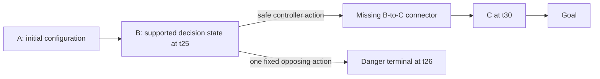

# Two-scenario development amendment v3

**Launch blocked; this is an unsealed preparation draft.** During preparation, the concurrent v2 completed at 10:42:29 p.m. EST on November 1, 2026. Its receipt records 188,832 transitions. Together with the earlier 210, this leaves only 71,758 of the original setup allowance. The proposed v3 cap below is now unaffordable within that allowance. No v3 manifest, approval or reservation has been created. The launcher refuses a v2 reservation rather than treating this as a fresh budget. The geometry choice and cumulative budget need reconciliation before launch; do not run the command below now. See VERIFICATION.json for the exact evidence snapshot.

This is the scoped correction to the approved two-scenario build. It preserves v1's failed setup, its completed diagnostic and the concurrently committed v2. V2 changes a radius fraction to 0.15; this package does not import or execute v2. A v2 reservation blocks this launcher until its work and budget can be reconciled.

## What changes and why

The original five-step B-to-C distance was 0.09838811676, giving a radius of 0.00983881168 under the 10% rule. That failed the 0.01 minimum. V3 specifies the **absolute connector radius as 0.01**, independent of route speed; B at step 25, C at step 30, the 20%/80% trimmed centerline, plant and tracking controller stay unchanged. This is a development-informed engineering amendment, not a retroactive pass or evidence that the width fits the recorder distribution.

The danger center is the first already prescribed opposing-action successor from B, taken from the authenticated diagnostic trace. Its radius retains the original rule: min(0.1, one quarter of its separation from all nominal route edges), with the unchanged 0.01 minimum. This creates a proposed immediate bad alternative at the same decision state as the safe route, rather than using the endpoint of five opposing actions. There is no action, radius or location search.

All geometry uses the benchmark's ten position/speed coordinates. This is a phase-space metric, not meters or a literal cliff. Harm comes from the explicitly approved danger-terminal penalty, not a claim of discovered chaotic physics or empirical thruster stall. Current and wave state plus actual time remain part of the full state and the observation. Physics and reward are identical between collection and evaluation within this task.

The saved 100-step nominal route and first opposing successor are reused with exact hashes and full-state continuity checks. This consumes **zero new construction transitions**. Geometry measurements and all named checks are saved before acceptance. Any overlap of hazard with the connector/goal, unsafe nominal first edge, invalid endpoint clearance or failed minimum radius stops setup; no fallback geometry is substituted.



The diagram is a proposed task structure, not completed physical validation or proof the connector is the only route.

## Physical checks before collection

Keep all 15 prespecified nuisance families, including the nominal start. Each family runs safe tracking, one opposing action at step 25 followed by nominal control if still live, and zero commands from step 25 onward. All variants must reach exactly the same B state through identical prefixes. Require:

- Nominal safe first action avoids danger; nominal opposing first action terminates in danger at step 26.
- At least 12/15 safe goals after C and by step 75, 12/15 first-action danger entries, 12/15 admissible safe first actions, and 12/15 safe connector traversals.
- Nominal safe continuation return from B exceeds danger and waiting by at least 5, using the complete finite-horizon discounted return, not immediate reward alone.
- Exact direct-versus-snapshot parity at the actual B state/time, including terminal status and reason.

These are fixed engineering validity checks. They do not establish trained-policy exposure, a critic's error sign or BCA efficacy. Failure stops before collection.

## Data and exclusion checks

One 1,280-parent bank uses the original independent seeds, start distributions and family-balanced role assignment: 768 fitting, 256 calibration, 256 reserved. Four recorder families are low-noise nominal, wider-noise nominal, the original low-noise family with only its step-25 action opposed, and zero-action-noise nominal including the safe step-25 alternative. No guarantee of safety or support is inferred from a family name.

The original collector code, schema and random-draw order are reused through one isolated recorder hook; original module globals and files remain unchanged. Every original transition retains its parent/row IDs, exact state and next state, actual time, action, reward and genuine terminal flag. No `next_actions` field is fabricated. Filtering never joins rows across a removed gap or turns the end of a fragment into an environment terminal.

Honeypot removes every tuple whose source, next state or connecting edge touches danger. Bottleneck applies the same rule to the connector. The exclusion applies to all learner streams, including auxiliary fitting, calibration and normalization. Retained approach support is measured only in fitting data at B/step 25 for Honeypot, and B/25 plus C/30 for Bottleneck. The original fixed metric remains exact time, physical L2 <= 0.10, current difference <= 0.005 and wave L2 <= 0.02.

Each condition requires zero forbidden retained edges, at least eight affected fitting parents, eight distinct retained fitting parents near each approach query, and 128 eligible independent calibration parents. Bottleneck also requires eight genuine retained prefixes and suffixes around one omitted connector block, through an original retained positive goal terminal. Fitting/calibration parents must be disjoint. Full raw-bank exact replay is a disclosed integrity check, not learning or model selection.

## Proposed scope and accounting before the concurrent v2 run

Already consumed: **210 physical transitions**, four geometry initializations and 6.074587407 measured Python seconds. Conservative prior charges remain **930 seconds**; unmeasured shell overhead is not invented or reclaimed.

| New phase | Maximum transitions |
|---|---:|
| 15 families x 3 witnesses x 100 steps, plus two parity steps | 4,502 |
| One 1,280-parent collection | 128,000 |
| One exact replay | 128,000 |
| **New setup cap** | **260,502** |

This fits the remaining 260,590 setup allowance, leaving 88 transitions unused at the maximum. The later evaluation reservation stays 237,600. Including prior work, the maximum total is **498,312**, below the original 498,400 ceiling. New geometry initializations are capped at 46 (50 cumulatively); collection at 1,280; Gym reset calls, model updates and calibration updates are zero.

Reserve 30 seconds for cheap preparation and 840 seconds for the manual setup: **870 seconds**, leaving **12,600 seconds (3h 30m)** for the later study. Prior charges + this phase + later reservation = 930 + 870 + 12,600 = 14,400 seconds. These are conservative allowances, not measured runtime claims.

The internal computation deadline is 825 seconds; the mandatory shell timeout is 835 seconds plus five-second kill grace. Missing terminal receipts or unfinished calls remain incomplete/uncertain. No automatic retry, new region search, threshold changes or extra collection is allowed. The exclusive v3 output directory prevents reuse of its own reservation. Local v2 receipt detection is not a distributed lock; do not launch v2 or a second copy concurrently.

## Later comparison remains disabled

No BCA method, BC strength, seed or training budget changes. The later proposal remains native UniFloral versus original actor score Q1 - 3U, three paired seeds per condition, fresh 10k native warmups and 10k continuations, 12 final policies through 18 jobs. Totals remain 180k critic, 90k actor, 180k auxiliary updates and 18 calibrations. No historical checkpoint initializes this new task.

Paired returns are primary. Raw critic own-policy Q errors, adjusted-score errors, over/under counts, beneficial/harmful corrections and unsupported choices remain separate. A downward-only penalty cannot directly raise an underestimated fixed Q. The connector scenario tests unsupported generalization and potential pessimism harm; geometric proximity does not guarantee stitching. Calibration outside the exclusions gives no conditional guarantee inside them.

Physical setup results, the final geometry/data/probe specification and real learner-runtime integration still require review before any training launch. This entry point has no learner or production dispatcher.

## Conditional manual setup, currently blocked

After the seal check passes, run once in PowerShell on Zeus; keep the terminal open:

```powershell
wsl -d Ubuntu -- bash -lc 'cd /mnt/c/Users/David/dev/BCA && timeout --signal=TERM --kill-after=5s 835s /home/david/bca-operator-audit-20261026/bin/python -B -u experiments/thrusterchain_bca/two_scenario_v3/setup.py --execute-setup'
```

The runtime must retain NumPy 2.5.4 and Gymnasium 1.0.0. The canonical source, cached evidence and protocol are hash-bound. Outputs go only to `two_scenario_v3/setup_attempt_1/`, including geometry diagnostics, physical witness evidence, dataset/replay/support evidence and the terminal receipt. Assistant-side WSL access remains denied; no alternate route was used to claim physical validation.
