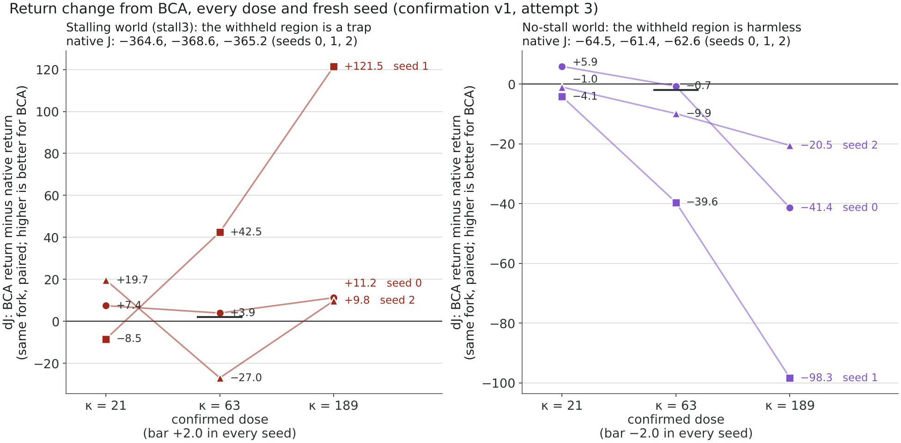
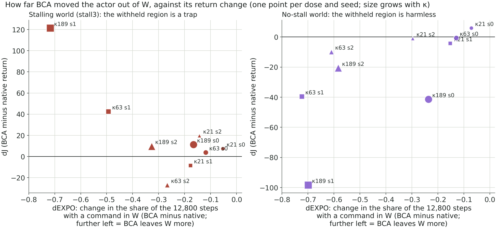

# Confirmation v1, attempt 3 (2026-11-02, 19:08 to 21:50 UTC, Zeus): the confirmed dose and the dose profile

**Reading: INCONCLUSIVE.** I1 failed in 2 of 24 evaluations, both in stall3: native seed 2 (1.86e-6 relative) and
BCA kappa 21 seed 0 (1.11e-6), against the A1 tolerance of 1e-6. I2 held in every unit and no read was non-finite.
Computed alongside, at kappa 63: C1 / C2 = **NOT CONFIRMED / OVER-CORRECTION**. Every unit completed: 13 stall3
training units reused from attempt 2 under the reuse rule, 17 training units and all 24 evaluations run here.
Record: `cf_run/attempt_3/` (`CF_RESULT.json` sha256 b136b39c…, `decision.json` 0fc0bd16…), manifest 6a524bf8….

This readout keeps three things apart: the verdict of the predefined test (section 1), what the data show at every
tested dose (section 2), and the open questions with what would test each (section 3).

## 1. Verdict (the predefined test, as recorded)

| | Recorded |
|---|---|
| Validity | INCONCLUSIVE: an instrument check failed (I1, two stall3 evaluations, above) |
| C1, stall3 at kappa 63 | NOT CONFIRMED: dJ +3.9 / +42.5 / −27.0 against ≥ +2.0 in every fresh seed |
| C2, no-stall at kappa 63 | OVER-CORRECTION: dJ −0.7 / −39.6 / −9.9; dEXPO −0.13 / −0.72 / −0.61; native W exposure 0.80 / 0.83 / 0.80 |
| Profile flags | exposure_monotone false; honeypot_gain_monotone false |

Attempt 3 is the last the rule allows (amendment A3: no attempt 4), so confirmation v1 closes INCONCLUSIVE. This is a
statement about this test. Kappa 63 was the dose being confirmed; kappa 21 and 189 were pre-registered as a profile,
reported without a bar, and the rule says the best-looking dose is not a confirmed dose. Everything in section 2 about
kappa 21 and 189 is description, not confirmation.

## 2. What the data show

### Every dose against every fresh seed, both worlds

dJ is the BCA actor's return minus the paired native actor's (same 10k fork; J is the mean exact return over the 128
starts; higher is better for BCA). Values are seeds 0 / 1 / 2.

| world | native J | kappa 21 | kappa 63 (confirmed dose) | kappa 189 |
|---|---|---|---|---|
| stall3 (W is a trap) | −364.6 / −368.6 / −365.2 | +7.4 / −8.5 / +19.7 | +3.9 / +42.5 / −27.0 | **+11.2 / +121.5 / +9.8** |
| no-stall (W is harmless) | −64.5 / −61.4 / −62.6 | +5.9 / −4.1 / −1.0 | −0.7 / −39.6 / −9.9 | **−41.4 / −98.3 / −20.5** |

- **Kappa 189 is the only dose with one sign in every seed of each world:** a gain in all three stall3 seeds (mean
  +47.5) and a loss in all three no-stall seeds (mean −53.4). At kappa 63 the no-stall loss is also in every seed while
  stall3 is mixed; at kappa 21 both worlds are small and mixed.
- The two worlds' returns sit on different scales (native about −365 against about −63), so a stall3 gain and a
  no-stall loss do not add up to anything.

### BCA moved the actor out of W everywhere, and the size of the change tracks how far

W exposure is `rates.w_any_depth`: the share of the 12,800 executed steps (128 starts × 100 steps) whose command lies
in W (|a0| > 0.8).

| world | native | kappa 21 | kappa 63 | kappa 189 |
|---|---|---|---|---|
| stall3 | 0.68 / 0.76 / 0.70 | 0.63 / 0.58 / 0.56 | 0.57 / 0.26 / 0.44 | 0.52 / 0.04 / 0.38 |
| no-stall | 0.80 / 0.83 / 0.80 | 0.73 / 0.68 / 0.50 | 0.67 / 0.11 / 0.19 | 0.56 / 0.13 / 0.22 |

- Exposure fell in **all 18** dose × seed × world cells (dEXPO −0.05 to −0.72). The pull out of W is world-blind, as C3
  said: in no-stall it fell as far as in stall3.
- Over the nine cells of each world, the Spearman correlation of dEXPO with dJ is −0.43 in stall3 (leaving W more goes
  with gaining more) and +0.75 in no-stall (leaving W more goes with losing more). The nine cells share three seeds'
  forks: a description of this run, not nine independent tests.
- **Seed 1 is the extreme in both worlds.** Its native actor already used W most (0.76 and 0.83), BCA moved it out
  furthest (0.04; 0.11 to 0.13), and it holds both the largest gain (+121.5) and the largest loss (−98.3).
- **Counterexamples.** Kappa 63 seed 2 in stall3 left W (−0.27) and lost 27.0. Kappa 189 seed 0 in no-stall left W
  less than the other seeds (−0.24) and still lost 41.4. Leaving W is neither sufficient for a gain nor the whole of a
  loss.

### The critic's error at the actor's own commands

e_own is the mean over the 48 visited states of Q1(s, π(s)) − Q^π(s, π(s)); positive is overestimation.

| world | native | kappa 21 | kappa 63 | kappa 189 |
|---|---|---|---|---|
| stall3 | +188.9 / +187.1 / +189.2 | +175.8 / +182.3 / +161.4 | +172.8 / +135.2 / +176.0 | +158.0 / +77.2 / +126.7 |
| no-stall | +8.2 / +6.5 / +3.7 | +4.8 / +9.2 / +7.1 | +7.6 / +29.3 / +14.0 | +23.5 / +47.1 / +18.8 |

- In stall3 the native critic overvalues its actor's own commands by about +188 at every one of the 48 states. BCA
  reduces that most at kappa 189 (de_own −31 / −110 / −63) but never removes it: every own command is still overvalued
  (share over 1.000 in every unit).
- In no-stall the native critic is close (+3.7 to +8.2). At kappa 63 and 189 BCA makes it worse (kappa 189 de_own +15
  / +41 / +15): the commands the actor moves to are ones its critic overvalues more.

### What the penalty can see

- The band hardly tells W from recorded commands: U_W − U_data is 0.014 to 0.048 in both worlds and every arm. At kappa
  189 the penalized score differs by only 3.7 to 8.5 between W and logged commands, against a penalty κ·U of about 550
  to 610.
- At the actor's own commands the worlds differ: in stall3 the native actors' commands sit where U is wider than at the
  logged ones (U_own − U_data +0.50 to +0.81); in no-stall they do not (−0.06 to 0.00).
- **The value of W itself.** At the 192 probe rows, under each native policy's exact continuation, the withheld
  commands (|a0| 0.85, 0.90, 1.00 in the logged command's direction; slots s05, s10, s20) are worth less than the
  logged command in both worlds: at full throttle by 2.3 to 2.6 in stall3 but only 0.38 to 0.44 in no-stall, and W is
  the better command on 26 to 36% of rows in either. Averaged over all rows, W is a mild cost in no-stall.
  *Revised 2026-11-03 (section 4):* by load band it is not. At deep load W is worth more than the logged command in
  no-stall, so this readout's first sentence here ("the no-stall loss is not explained by BCA giving up commands that
  are worth more there") held only for the all-rows average, which the 100 low-load rows dominate.
- **Gradient audits** (`gradient_audit_020000.json`; 400 fixed high-load probe rows; a training-only diagnostic of the
  direction each loss term pushes, not an executed move). Where the actor sits outside the band, the critic's Q term
  pushes the command outward on most rows in both worlds (198 of 227 rows, stall3 kappa 189 seed 1; 193 of 248,
  no-stall kappa 189 seed 1). The cosine of the penalty's actor-parameter gradient with the Q term's falls with kappa:
  at kappa 21, −0.29 to −0.57 in stall3 but +0.05 to +0.48 in no-stall; at kappa 189, −0.75 to −0.93 in five of six
  units (stall3 seed 2: −0.39). At kappa 189 the audits look alike in both worlds.

### The instrument misses

I1 compares the reference Q^π with the rollout return at the 16 visited states with t = 0. A 1.9e-6 relative miss on
returns of a few hundred is about 0.0007 in return. dJ comes from the exact rollouts and does not involve I1; e_own
uses a Q^π that agrees with the rollouts to 2 parts per million. No number in this readout changes at the precision
shown. The verdict stays INCONCLUSIVE because the rule names the tolerance.

## 3. Open questions

Each is a hypothesis, with what would test it. Questions 1 to 3 use saved records only and claim nothing
confirmatory. Questions 4 and 5 need new runs under a new rule written before them.

1. **One mechanism or two?** Hypothesis: one world-blind pull out of W, sized by kappa, makes both the stall3 gain and
   the no-stall loss. *Test, saved records:* every evaluation saves W exposure by load band (`rates.by_band`, mid and
   deep; the start bank has no low-load steps). Does the exposure drop concentrate in the deep band in both worlds? A
   per-start pairing of the saved returns (128 per evaluation) with per-start exposure would need the saved checkpoints
   re-evaluated (git-ignored, on Zeus; about 25 s each; evaluation only). *Load-band part answered in section 4; the
   per-start pairing with exposure remains open.*
2. **When does leaving W help, and when does it suppress useful behavior?** At typical data states W is a mild cost
   even in no-stall, yet leaving it cost up to 98 points there. Candidate: the loss lives at high-load states, where
   full push matters and no-stall rewards it. *Test, saved records:* the Q^π(W) − Q^π(logged) comparison on high-load
   probe rows only; then the true value of the actor's own command under the native and BCA actors at the same visited
   states, per world. *Answered in part in section 4: in no-stall W is worth more than the logged command at deep load,
   and the loss is spread over every start. The two actors share visited states only at t = 0, so the per-state
   comparison is read through the per-start returns instead.*
3. **Why seed 1?** It is the extreme in both worlds and started with the most W exposure. *Test, saved records:* the
   three native actors' exposure by load band and own-action error. Is seed 1's actor the one nearest the knee?
   *Section 4: partly; three seeds do not settle why it is the extreme.*
4. **Can a penalty spare a harmless W?** The band barely separates W from recorded commands, and at kappa 189 its
   gradient opposes the critic's alike in both worlds, so nothing in it knows which world it is in. The overestimation
   rule's own text calls this "the underestimation failure of a sign-blind penalty". *Test, new runs:* a new package
   comparing the current penalty with one that acts only where the critic overestimates, or only on the band's excess at
   the actor's own command. Matched displacement, both worlds, fresh seeds, bars written first.
5. **Does kappa 189's stall3 gain reproduce?** *Test, new runs:* a new package naming kappa 189 as the dose being
   confirmed, with a fresh seed namespace (`knee_s10_candidate_v2/confirmation/` is used), and both the stall3 bar and a
   no-stall cost bar stated before any run. This run's kappa 189 values can inform those bars but cannot count toward
   them. *Taken up by `../confirmation_v2/` (sealed 2026-11-03, manifest 8e4d21b2…, not yet run).*

## 4. Follow-up from saved records (2026-11-03)

Open questions 1 (load-band part), 2 and 3, answered from the saved records alone: nothing was trained, evaluated or
simulated. Script `analysis/confirmation_v1_kappa_profile/analysis_saved.py`, output `analysis_saved.json` beside it.
Each probe row's load band is read from the formal G2 v2 datasets the runs used (archives 5f4933fc… stall3, 125131d7…
no-stall) at its [episode, t] index; the script checks that every probe row's logged command equals the dataset's
action there exactly. Load g = obs10 + obs11 (`knee_edge_ood_v3/knee_region.py`); bands low g < 0.4, mid 0.4 to 1.0,
deep g ≥ 1.0. Of the 192 probe rows, 100 are low, 81 mid and 11 deep; every executed step from the 128 starts is mid or
deep (6,373 and 6,427 of the 12,800 steps). Values are seeds 0 / 1 / 2.

### Where W is worth more (question 2)

Q^π(W at full throttle) − Q^π(logged) at the probe rows, under each native actor's exact continuation, and the share
of rows on which W is the better command:

| world | low load (100 rows) | mid load (81 rows) | deep load (11 rows) |
|---|---|---|---|
| stall3 | −0.18 / −0.12 / −0.01 (W better on 30 to 32%) | −4.45 / −4.93 / −4.61 (22 to 25%) | −10.53 / −6.25 / −6.32 (9 to 18%) |
| no-stall | −0.79 / −0.72 / −0.74 (29 to 30%) | −0.15 / −0.11 / −0.17 (35 to 36%) | **+0.56 / +0.60 / +0.53 (64 to 73%)** |

- In no-stall, W is worth more than the logged command exactly at deep load, and worse at low load. The deep-load
  read rests on 11 rows. In stall3, W is worse at every load, most at deep load. This revises section 2's all-rows
  statement.

### Where BCA gave up W (question 1, load bands)

W exposure among the executed steps, by load band:

| world | arm | mid load | deep load |
|---|---|---|---|
| stall3 | native | 0.64 / 0.71 / 0.66 | 0.73 / 0.80 / 0.75 |
| stall3 | kappa 63 | 0.51 / 0.24 / 0.41 | 0.63 / 0.29 / 0.46 |
| stall3 | kappa 189 | 0.49 / 0.05 / 0.34 | 0.55 / 0.03 / 0.42 |
| no-stall | native | 0.65 / 0.68 / 0.64 | 0.95 / 0.98 / 0.96 |
| no-stall | kappa 63 | 0.42 / 0.06 / 0.09 | 0.92 / 0.16 / 0.29 |
| no-stall | kappa 189 | 0.25 / 0.11 / 0.17 | 0.87 / 0.16 / 0.26 |

- In no-stall, seeds 1 and 2 gave up deep-load W at kappa 63 and 189 (0.98 to 0.16; 0.96 to 0.29 and 0.26), where W
  is worth more, and lost at both doses (−39.6 and −98.3; −9.9 and −20.5).
- Seed 0 kept deep-load W at both doses (0.92, 0.87). At kappa 63 it lost almost nothing (−0.7); at kappa 189 it lost
  41.4 while its mid-load W fell further (0.42 to 0.25). The deep-load account does not cover seed 0's kappa 189 loss.
- In stall3 the drop is spread over both bands, not concentrated at deep load.

### Per start (question 2)

The share of the 128 starts on which BCA's return is lower than the native actor's:

| world | kappa 63 | kappa 189 |
|---|---|---|
| stall3 | 0.45 / 0.05 / 0.95 | 0.37 / 0.00 / 0.45 |
| no-stall | 0.59 / 1.00 / 1.00 | **1.00 / 1.00 / 1.00** |

- At kappa 189 BCA's return is lower on every start in all three no-stall seeds, and the worst tenth of starts carries
  only 12 to 14% of the loss: a shift of the whole policy, not a few bad starts.
- In stall3 at kappa 189, seed 1 gains on every start (median +117.5). Seeds 0 and 2 gain on 63% and 55% of starts
  (medians +7.2 and +2.7). At kappa 63, stall3 seed 2 is lower on 95% of starts.

### Seed 1 (question 3)

The native actors at the 48 visited states:

| world | own commands past the knee | own commands at 0.7 to 0.8 | median own abs(a0) | W exposure |
|---|---|---|---|---|
| stall3 | 0.56 / 0.69 / 0.60 | 0.02 / 0.04 / 0.00 | 0.87 / 0.97 / 0.95 | 0.68 / 0.76 / 0.70 |
| no-stall | 0.81 / 0.77 / 0.81 | 0.06 / 0.10 / 0.02 | 0.93 / 0.95 / 0.94 | 0.80 / 0.83 / 0.80 |

- In stall3, seed 1's native actor sits deepest in W (median abs(a0) 0.97, 69% of its commands past the knee). In
  no-stall it has the most commands just under the knee (10%). Partly "nearest the knee", but three seeds do not
  settle why it is the extreme in both worlds.

### What remains open

- Question 1's per-start pairing of exposure with return needs the saved checkpoints re-evaluated (on Zeus,
  git-ignored).
- Question 4 needs new runs. Question 5 is taken up by `../confirmation_v2/`, which also reports deep-load W exposure
  and the share of starts lower in every seed and world.

## Provenance

- `cf_run/attempt_3/decision.json`: paired reads, per-unit reads (J, exposure, e_own, e_data, e_W, U, penalized error)
  and instrument flags. `CF_RESULT.json`: reading, labels, profile, caps. I1 values: each evaluation's `report.json`,
  `instrument`. Q^π at the probe rows: the native evaluations' `data.qpi` (192 rows × slots logged, s05, s10, s20).
- Gradient audits: `bca_branch_s{i}_k{kappa}_{world}/gradient_audit_020000.json`; the 13 reused stall3 units are read
  from `cf_run/attempt_2/`.
- Definitions follow `CONFIRMATION_RULE.md` and `../overestimation_v1/oe_math.py`. Exposure is
  `knee_edge_ood_v3/stage1_eval.py` `step_rates`; the penalized error is e − κ·U.
- Figures: `analysis/confirmation_v1_kappa_profile/make_figures.py`, which reads `decision.json` only. Section 4:
  `analysis/confirmation_v1_kappa_profile/analysis_saved.py` (evaluation reports and the two formal G2 v2 datasets,
  numpy only), output `analysis_saved.json`. The Spearman
  correlations are over the nine dose × seed cells per world.
- Nothing was trained, evaluated or simulated for this readout.

## Ledger entry

Confirmation v1, attempt 3 (Zeus, 2026-11-02 19:08-21:50 UTC, manifest 6a524bf8…): INCONCLUSIVE (I1 1.86e-6 and
1.11e-6 against 1e-6 in two stall3 evaluations); computed alongside, C1 / C2 at kappa 63: NOT CONFIRMED /
OVER-CORRECTION, stall3 dJ +3.9, +42.5, −27.0 and no-stall dJ −0.7, −39.6, −9.9. Dose profile, dJ at kappa 21 / 63 /
189: stall3 (+7.4, −8.5, +19.7) / (+3.9, +42.5, −27.0) / (+11.2, +121.5, +9.8); no-stall (+5.9, −4.1, −1.0) / (−0.7,
−39.6, −9.9) / (−41.4, −98.3, −20.5). W exposure falls at every dose in every seed and world (native 0.68 to 0.76
stall3 and 0.80 to 0.83 no-stall; kappa 189 0.04 to 0.52 and 0.13 to 0.56); de_own at kappa 189 −31, −110, −63
(stall3) and +15, +41, +15 (no-stall). exposure_monotone false, honeypot_gain_monotone false. Training 2.52 h
logical (reused units at their original cost), 2.69 h of training and evaluation run in this attempt; 1,313,952
exact transitions. Last attempt (A3): confirmation v1 closes INCONCLUSIVE.
